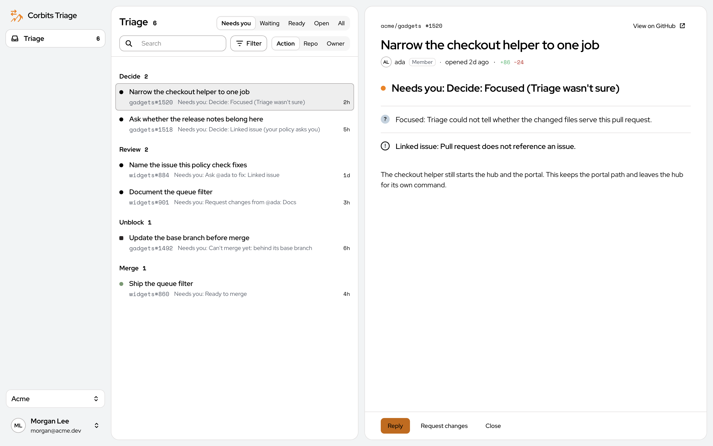

<p align="center">
  
</p>
<h1 align="center">Corbits Triage</h1>
<p align="center">Take control of your PRs and your dev team</p>
<p align="center">
  <a href="https://github.com/corbitsdev/corbits-triage/actions/workflows/ci.yml"></a>
</p>
<p align="center">
  <a href="https://github.com/corbitsdev/corbits-triage/blob/main/docs/Corbits%20Triage%20User%20Manual/Corbits%20Triage%20User%20Manual.md">User manual</a> ·
  <a href="https://github.com/corbitsdev/corbits-triage/blob/main/docs/SELF_HOST.md">Self-hosting</a> ·
  <a href="https://github.com/corbitsdev/corbits-triage/blob/main/CONTRIBUTING.md">Contributing</a> ·
  <a href="https://github.com/corbitsdev/corbits-triage/blob/main/SECURITY.md">Security</a>
</p>



## How it works

1. **Connect a source.** A GitHub App or Bitbucket Data Center.
2. **Add a policy.** `.corbits-triage.yml` on the default branch, or **Start a policy file**.
3. **Save a decision model.** In Settings, not as a hub variable.
4. **Turn triage on** for the repository.
5. **Read the queue.** Verdict, reasons, and the actions the policy names.

Nothing runs until triage is on for the repository and a decision model is saved.

## Quick start

**With your coding agent.** In the folder where you'll set it up, add the Corbits Triage skills, then give your agent the Setup Prompt:

```sh
npx skills add corbitsdev/corbits-triage
```

```text
Set up Corbits Triage on this machine with the corbits-triage-install skill. Use Docker if I have it, otherwise my own Postgres. Tell me when you need me to do something.
```

**With Docker.** Compose builds from a checkout.

```sh
cp .env.example .env
docker compose up -d
```

Open http://localhost:3000. Ports, logs and running on a server are in [Self-hosting](docs/SELF_HOST.md).

**From source.** With Bun 1.4.4+ and Postgres 15+, see [Development](docs/DEV.md). The portal for that path is http://localhost:5173.

Then create an account, open **Set up Triage**, and save the decision model. To have an agent write the policy, use the [Configure Prompt](docs/Corbits%20Triage%20User%20Manual/Corbits%20Triage%20User%20Manual.md#writing-the-file).

## Docs

- [User manual](docs/Corbits%20Triage%20User%20Manual/Corbits%20Triage%20User%20Manual.md): the portal, screen by screen.
- [Self-hosting](docs/SELF_HOST.md): running it and every setting.
- [Development](docs/DEV.md) and [Contributing](CONTRIBUTING.md): working on the code.
- [AGENTS.md](AGENTS.md): conventions for coding agents.
- [skills/](skills): agent skills to install Triage and write a policy.
- [Product](docs/PRODUCT.md): rules, verdicts, actions and the policy file. [Bitbucket Data Center](docs/BITBUCKET_DATACENTER.md): connecting that host.
- [GitHub emulator](docs/DEV.md#github-emulator-no-github-account), the [policy-check Action](packages/policy-check-action/action.yml) and the [browser extension](apps/extension/README.md).

Triage runs as workflows on an [Interchange](https://github.com/faremeter/interchange) hub, which owns identity, grants, credentials, runs and audit.

## License

GPLv2 with the [AI Exception](GPLv2-AI-Exception.md); see [LICENSE.md](LICENSE.md). Contributions require the [CLA](CLA.md).
