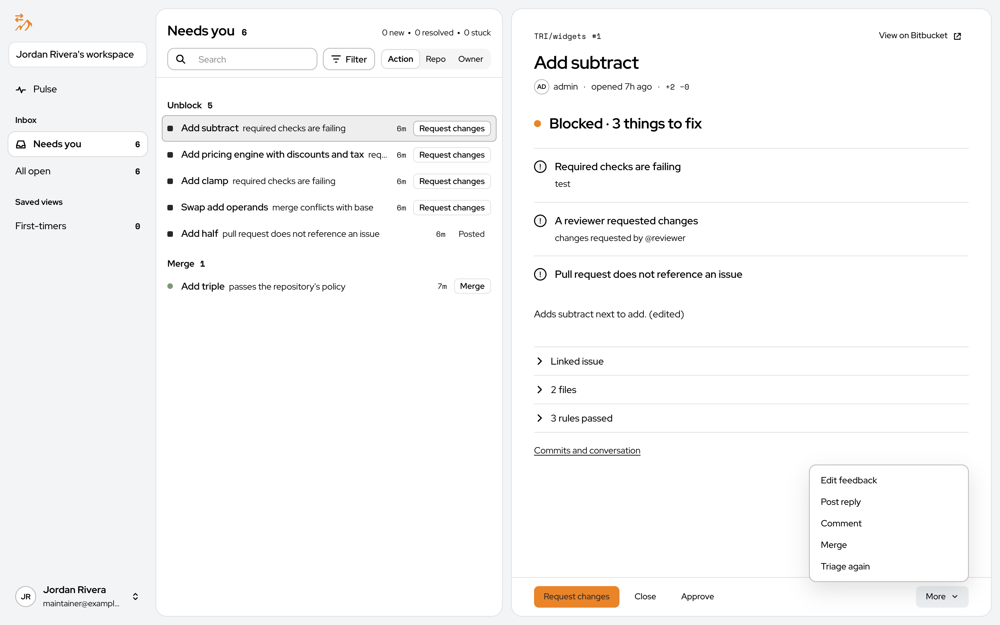
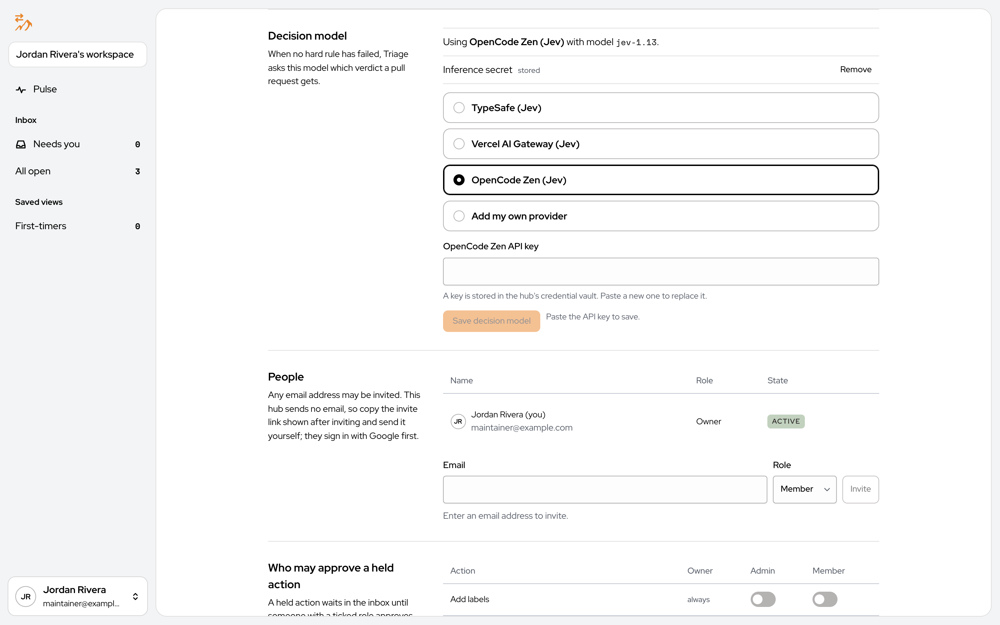
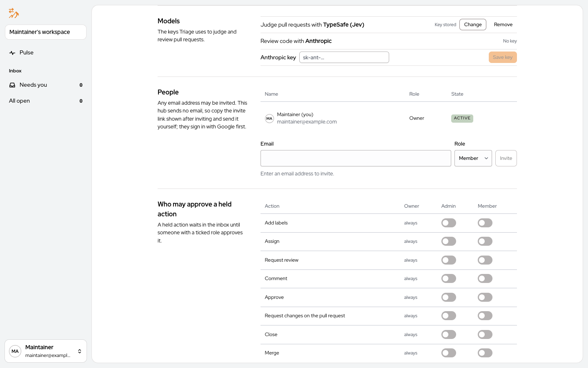
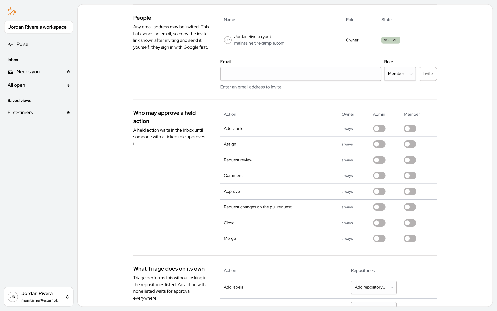
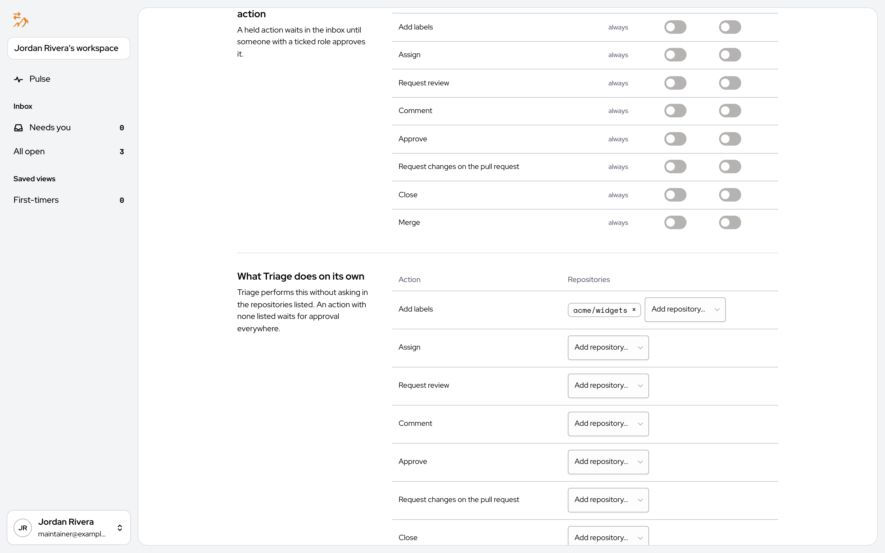

# Corbits Triage User Manual

Oct 16, 2026 · @Brian J. Fox

## Contents

1. [What Corbits Triage is](#what-corbits-triage-is)
2. [Getting started](#getting-started)
3. [Setting up a repository: rules, verdicts and actions](#setting-up-a-repository-rules-verdicts-and-actions)
4. [Day to day: the Inbox](#day-to-day-the-inbox)
5. [Settings: people, access and workspace configuration](#settings-people-access-and-workspace-configuration)
6. [The audit log](#the-audit-log)
7. [Glossary and common questions](#glossary-and-common-questions)

## What Corbits Triage is

Corbits Triage is an assistant for people who maintain code on GitHub or Bitbucket Data Center. It looks at every open pull request in the repositories you choose, checks each one against the rules you set, and tells you whether it looks good to merge. Every pull request gets one of three verdicts: **Pass**, **Fail** or **Unsure**, along with a short list of reasons.

Think of it as a first reader. It does the routine checking (Did the tests pass? Is the change too big? Is there a linked issue? Does it need documentation?) so that you can spend your time on the pull requests that actually need a human opinion.

### Who uses it

- **Maintainers** open the portal, a web page where they see each pull request's verdict, its reasons and a suggested next step.
- **Teams** share one workspace. An admin invites teammates by email and decides who may do what.
- **Pull request authors** never need to log in. They only see what Triage writes on the pull request: comments, review requests, and labels and assignments on GitHub or a build status on Bitbucket.

### What it never does on its own

Nothing runs until you turn it on. Connecting GitHub or Bitbucket Data Center only records your repositories, with triage switched off. A repository is checked only after someone turns on **Triage pull requests in this repository**. Enabling a repository switches on Comment and Labels for it; every other action waits for a person to click until you decide which actions Triage may run by itself, and in which repositories. Code review, too, runs only in repositories where someone switched it on, and it never writes to the pull request.

### The three parts

1. **The portal** is the website you use. This manual is about the portal.
2. **The hub** is the server that stores your settings, talks to GitHub or Bitbucket and runs the checks. You normally never see it.
3. **The decision model** is an AI service that answers the judgment questions rules cannot answer from repository data alone, such as "Is this change focused on one thing?" You connect it once in Settings.

### Code review

Code review reads each new commit of a pull request for bugs: mistakes in the changed lines and breakage the change causes elsewhere in the repository. It is separate from the verdict and optional.

- **Turning it on.** Save an Anthropic API key under [Settings → Models](#models), then switch on **Review the code in every pull request for bugs** in each repository's [Code review section](#code-review-1). Switch it off there to stop.
- **What it costs.** Each commit it reviews is billed to your Anthropic account. It reviews a pull request when it is opened and after every push while it is not a draft, and **Review again** is one more review.
- **Where you see it.** In the Inbox's reading pane, under **Code review**: each bug with how severe it is, its file and line, and the code it points at. **Review again** reviews the latest commit once more. A very large change is read up to a size limit, and the review says how much of it was read.
- **What it does not do.** It only reads code; it never runs it. Nothing is posted to the pull request: findings stay in Triage.

## Getting started

You use Corbits Triage through a website called the portal. Your administrator will give you its address. Everything in this section happens in a normal web browser.

### Signing in

Open the portal address. You will see the sign-in screen.


Type your email address and password and press **Sign in**. If your organization uses Google sign-in, a **Google** button appears instead of, or below, the password fields. If the sign-in screen shows **Forgot password?**, use it to reset a forgotten password.

### Creating an account

If you are the first person from your team, click **Sign up for an account**. The form asks for your name, your email address and a password.


Creating an account also creates a **workspace**, the shared space your whole team will use. Teammates do not create their own workspaces. Instead, you invite them from Settings, and they join yours. If someone has already invited you, open the link in the invitation email instead of creating an account from scratch.

### First-time setup

The first time you sign in to a new workspace, the portal walks you through three steps. Until all three are done, Triage does not look at any pull requests.


1. **Connect a source.** A source is where your pull requests live: GitHub or Bitbucket Data Center. Triage talks to GitHub through a GitHub App. Press **Create GitHub App** and GitHub opens with a prefilled form for you to confirm. GitHub then sends you back to the portal. The App's private key is stored on the Triage server and is never shown in the browser. If your organization already has a GitHub App for Triage, expand **Connect an existing GitHub App instead** and enter its App ID, its slug, its private key file and its webhook secret. The portal shows the webhook URL you must paste into the App's settings on GitHub.

   

   If your team uses Bitbucket Data Center rather than GitHub, expand **Use Bitbucket Data Center instead** and connect your instance as described under [Sources](#sources).

   
2. **Repositories.** On GitHub, press **Choose repositories on GitHub** and pick which repositories the App may see. GitHub tells Triage which ones you chose. With Bitbucket Data Center there is nothing to pick: Triage lists every repository the token can see, and you turn triage on for each one under Repositories. Either way they arrive with triage switched off, so nothing runs yet.
3. **Decision model.** Pick an AI provider from the list, paste the key your provider gave you, and press **Save decision model**. The key is stored in the server's vault and you will not see it again. If your organization runs its own compatible model service, choose **Add my own provider** and enter its address, model name and key.


You can also invite teammates from this screen by expanding **Invite people**, or do it later from Settings.

### After setup

Once all three steps are done, the portal takes you to the Inbox. Nothing appears there yet, because triage is still off for every repository. The next section shows how to turn it on, and the one after it shows what you will see.

## Setting up a repository: rules, verdicts and actions

Every repository has its own page under **Repositories** in the menu under your name. A repository's rules, and what Triage does with each verdict, live in a file in the repository called `.corbits-triage.yml`. The page reads that file back to you. From top to bottom it holds the triage switch, the **Policy**, **Code review**, **Actions Triage takes on its own**, **Outcomes** and **Remove repository**. Switches are saved as you change them; the word beside the repository's name says **Saving…** while a change is on its way, **Saved** once it is stored, and **Not saved** if the save failed.


### Turning triage on

The switch labeled **Triage pull requests in this repository** is the master control. While it is off, Triage ignores the repository entirely and the rest of the page is grayed out. You can turn it on before the policy has any rule: the page then says **Triage is on. It starts once the policy has a rule.** and nothing is checked until it does. Once the policy has a rule, Triage checks every open pull request, and from then on it reacts to each new pull request event as it happens. On GitHub, the link **Triage open pull requests again** re-checks everything that is currently open, which is useful after you change the policy. When the run finishes, each pull request's new result replaces its old one in the inbox. Drafts are skipped until they are marked ready for review; one without a result shows **Draft** and **Draft: Not evaluated** instead of **Not triaged yet** and **Not evaluated**.

### Bitbucket Data Center repositories

Repositories from Bitbucket Data Center are named by project key and repository, such as `TRI/widgets`, and carry a **Bitbucket Data Center** mark under their name in the list. The link in the corner of the repository page opens it on Bitbucket.


Bitbucket tells Triage about pull request events through a webhook on each repository. When you turn triage on, Triage creates that webhook itself if its token is allowed to. If not, the page shows **Webhook setup** with the webhook URL, a secret and the list of events. A repository admin on Bitbucket then:

1. Opens the repository, then **Repository settings → Webhooks → Create webhook**.
2. Names it **Corbits Triage** and pastes the URL.
3. Pastes the secret.
4. Selects the events listed and leaves the webhook active.
5. Saves.

The secret is shown only this once. Turning triage off removes a webhook Triage created; one set up by hand stays until an admin deletes it.

A few things work differently from GitHub, because Bitbucket works differently:

- **No labels.** Bitbucket Data Center has no labels, so verdict labels and **Add labels** steps have no effect there. Triage shows its verdict as a build status named **Corbits Triage** on the pull request's latest commit instead, while Comment is on for the repository.
- **No assignments.** Bitbucket has no assignees, so **Assign to** steps are not carried out.
- **Bitbucket's own reviews.** Approve, Request changes, Close and Merge become Bitbucket's approve, needs work, decline and merge.
- **CI is checked on a timer.** Bitbucket sends no event when a build finishes, so a pull request waiting for CI is checked within a few minutes of its builds ending. While the **CI must pass** rule is waiting on a build, or failing because of one, Triage looks at the build again after five minutes, then less often, and checks the pull request again once it has changed.

### Policy

A repository's policy is the file `.corbits-triage.yml` (`.corbits-triage.yaml` works too) on its default branch, so changes to it are reviewed like any other code. The **Policy** section reads it back in plain sentences: each rule that is on, then what Triage does on **Pass**, **Fail** and **Unsure**. Rules and actions change only in the file. **Change on GitHub**, or **Change on Bitbucket** for a Bitbucket repository, opens it there.

- With no file, the section says to add `.corbits-triage.yml` to the default branch.
- When a change to the file reaches the default branch, the next triage uses it.
- If the file has a mistake, Triage runs nothing on the repository until it is fixed. The section says so and lists each problem, and the Inbox names the repository. A repository that still has rules saved in Triage keeps running on them instead, and its card below says **Triage can't read** the file and why.

#### Moving saved rules into the file

A repository set up before policy files has its rules saved in Triage. They move into the file once, through a pull request, with one card in the Policy section that walks through the steps **Review**, **Open pull request**, **Merge on GitHub** (or Bitbucket) and **Done**. Your saved rules keep applying until the move is done.

- **Move this repository's rules into a policy file.** The repository has saved rules and no file. **Open the pull request** opens one adding the file with your saved rules and actions. Anything a file can't hold is listed above it, one plain line each, such as "Risk stops after the merge; a policy file can't hold it."

  

- **Your policy file differs from your saved rules.** The repository has both, and they don't do the same thing. Each difference shows the rule with its **Saved** and **File** values, the changed value marked. **Update the file to match** opens a pull request changing the file to your saved rules. **Use the file instead** keeps the file as it is and puts the saved rules away. It first asks you to confirm, with one line for each thing that will change, such as "Pull requests that change vendor/** will no longer fail." Press **Use the file** to go ahead, or **Cancel**.

  

  

- **While the pull request is open,** the card shows it as **Open, waiting for merge**, with **Merge on GitHub** to open it there. **Update the pull request with your saved rules** brings it up to date; a second one is never opened. The card notices the merge on its own. If your file differs, **Use the file instead** is still offered.

  

- **Finish moving to the policy file.** The file holds everything from your saved rules that a file can hold. What is left is shown as a difference; press **Use the file**, then confirm, to switch.

  

Once the move is done, the file alone is the policy. If the page is open when that happens, the Policy section says **Done. Your rules now come from .corbits-triage.yml.** above the rules.


The Repositories list marks each repository that still has a step to take: **Move rules to a file**, **Rules differ from file**, **Waiting for merge** or **Switch to the file**. The Inbox shows the same words in one line, each repository linking to its page.


#### Writing the file

In the file, each rule is one sentence with how it is checked and why it exists: a one-line `reason` and its `evidence`, such as the pull requests that led to it (`"#44"`) or `maintainer-stated`. For example:

```yaml
rules:
  - check: max-lines-changed
    text: A pull request changes at most 400 lines.
    max: 400
    reason: Large changes were split before review.
    evidence: ["#44", "#57"]
```

A file exported before rules carried reasons keeps working as it is.

A file can also start from a workspace-wide policy with `extends`, and then set only what differs for this repository. This is useful when many repositories should follow the same rules.

#### Checking the file in pull requests

On GitHub, a mistake in the file can be caught before it reaches the default branch. Add this workflow to the repository as `.github/workflows/corbits-triage-policy.yml`:

```yaml
name: Corbits Triage policy
on:
  pull_request:
    paths: [".corbits-triage.yml", ".corbits-triage.yaml"]
permissions:
  contents: read
jobs:
  check:
    runs-on: ubuntu-latest
    steps:
      - uses: actions/checkout@v4
        with:
          persist-credentials: false
      - uses: corbitsdev/corbits-triage/packages/policy-check-action@main
```

Each pull request that changes the file then gets a **Corbits Triage policy / check** check. It reads the file exactly as Triage does and fails if Triage could not read it. Each problem is marked on its line in the pull request's **Files changed**, or on the file as a whole when it has no line. It needs no Triage account and no secrets, and sets up its own Bun for the job. `@main` will be replaced by a release tag with the first pre-release.

### Rules

A rule asks one question about a pull request and answers pass, fail or unconfirmed. The Policy section shows each rule that is on as one sentence. A file can turn on:

- **Size**: **Flag pull requests over N files changed** and **over N lines changed**. Big changes are hard to review. You choose the limits.
- **Facts the host already knows**:
  - **Require a linked issue** from GitHub, Linear or either. The pull request's title, description, commits or branch must mention an issue.
  - **Flag merge conflicts with the base branch.**
  - **CI must pass before merge.** The repository's automated checks must be green. While they are still running, the rule is unconfirmed rather than passed.
  - **Never accept changes to** certain paths, such as vendored code.
  - **Fail when …**, a text rule of your own, such as "Fail when any commit message contains "Co-Authored-By:"". It names where to look (the title, the description, any commit message, or several of them), whether the rule fails when the text **contains** or **does not contain** its phrases, and the phrases. Case does not matter. Only the first 100 commits are read. The rule's evidence quotes the line that matched. Text rules count toward the eight rules of your own.
- **Judgement**, questions the decision model answers from the diff and the documentation:
  - **Check the change is focused on one thing.**
  - **Check docs are updated when behavior changes.**
  - **Is it true that …**, a yes-or-no question of your own, such as "Is it true that the title says what changed?" The rule fails when the answer is no.

Two rules always run: a draft pull request waits until it is ready for review, and a pull request with changes requested fails. Once the author pushes a new commit or replies, it still fails but waits on the reviewer, in **Needs you** as ready for re-review, until that reviewer approves or requests changes again.

Size rules and facts the host already knows cost nothing and always give the same answer for the same pull request. Judgement rules cost one model request per pull request.

### How the verdict is decided

1. If any rule fails, the verdict is **Fail** right away. That includes a Judgement rule the decision model answered no to.
2. If the policy has no Judgement rules, there is nothing left to judge: the verdict is **Pass** when every rule passes, and **Unsure** when a rule could not be confirmed, such as CI that is still running.
3. Otherwise the decision model reads the whole pull request together with every rule's result and answers one question: does this pull request pass this repository's policy? If it is at least 70% sure the answer is yes, the verdict is **Pass**. If it is at least 70% sure the answer is no, the verdict is **Fail**. Anything in between is **Unsure**, which means a person should look. A pull request with a Judgement rule the model could not confirm is never more than Unsure.

Draft and closed pull requests are not decided at all.

### Actions

The file lists steps for each verdict, and the Policy section shows them under **Pass**, **Fail** and **Unsure**, or **Nothing** when a verdict has none. Each step names an action and who it is for.

| Action | What it does |
| --- | --- |
| Approve | Approves the pull request. |
| Merge | Merges the pull request. Only on Pass. |
| Close | Closes the pull request. |
| Comment | Posts the comment the step gives. |
| Request changes | Sends the author a review listing the rules to fix. |
| Request review from | Asks the code owners, named people or teams to review. |
| Assign to | Assigns the pull request to the author, the code owners, named people or teams. |
| Add labels | Adds the labels the step lists, or one label for each failed rule. |

A step can be limited to some authors, shown after it, such as "Approve, for maintainers": **first-timers**, **maintainers**, **external contributors** or **bots**; one kind of author as GitHub reports it; a GitHub team; or specific people. A step for anyone shows no one. For example, a Fail step can post a friendly comment for external contributors only. In the file, authors are named by GitHub's own author types: `OWNER`, `MEMBER`, `COLLABORATOR`, `CONTRIBUTOR`, `FIRST_TIME_CONTRIBUTOR`, `FIRST_TIMER`, `NONE` and `MANNEQUIN`, plus `BOT` for bots. A file that names first-timers, maintainers, external or bots still works and means the same authors as before.

A step can also run only when the pull request links an issue (or does not), when its CI is passing, failing, pending or absent, or when it changes more or fewer files or lines than you say. These conditions are written under the step's `when`; the page shows only who a step is for.

Under Code review, **Actions Triage takes on its own** lists each action with its own switch. On, Triage does that action in this repository without asking; off, it waits for you in the Inbox, in this repository only. An action allowed in every repository under [Settings → Access](#access) shows on and changes only there. Bitbucket Data Center repositories list **Comment and build status** instead of Comment, and do not list Add labels or Assign; Settings → Access does not offer them for those actions.

Enabling a repository switches on Comment and Add labels (Comment only on Bitbucket, which has no labels); every other action waits for a person to click until you switch it on, so you can watch what Triage suggests before you let it act. Turning triage off and on again switches them back on. Two actions are always held for a person: Close on Unsure, and Merge on anything but Pass.

When the policy depends on CI (the **CI must pass** rule is on, a step has a CI condition, or a step approves or merges), Triage waits for a pull request's CI to finish before it checks it, so it gives one result instead of an early Unsure. Meanwhile the Inbox shows **Waiting for CI** (**Waiting for CI · new commits since Triage checked** when an earlier result is still on show). A pull request that already needed you stays in Needs you meanwhile; one Triage has not checked yet waits under **Waiting**. The pull request's page notes **New commits since Triage checked** above the earlier result, which stays until the new one lands. The pull request itself shows **Triage: Waiting for CI**, as a label on GitHub where Triage adds labels on its own and as the **Corbits Triage** build status on Bitbucket where Triage comments on its own. The verdict replaces it once Triage has checked the pull request. Triage goes ahead as soon as any check fails, after two minutes when the repository has no CI, and after an hour at most. **Triage again** does not wait.

If Triage checks a pull request while its CI is still running anyway, it holds every action, and its comment on the pull request lists them under **Waiting for checks to finish**. They go ahead once the checks are done.

### Labels

Triage keeps a verdict label on every pull request so that other tools, such as a coding agent, can react to it. It puts the verdict's label on the pull request and takes the other two off. The defaults are **Triage: Ready** for Pass, **Triage: Not Ready** for Fail and **Triage: Needs Human Review** for Unsure; the file can rename them. A step that labels each failed rule, shown as **Label each failed rule**, adds a label such as `rule: linked-issue` for every rule that failed.

On Bitbucket Data Center labels have no effect; see [Bitbucket Data Center repositories](#bitbucket-data-center-repositories).

### Code review


Code review reads each new commit of a pull request for bugs. It runs whether or not triage is on for the repository, and skips drafts. Switch on **Review the code in every pull request for bugs** to start it, and off to stop. It needs the workspace's Anthropic key: until one is saved, the section says **Needs an Anthropic key in Settings → Models**, with a link to [Models](#models).

### Where code review runs

Code review runs on the server that runs Triage, beside Triage itself.

### Removing a repository

**Remove repository**, at the bottom of the repository page, asks you to confirm, then stops Triage on that repository and takes it off Repositories. Its pull requests leave the Inbox and Pulse. For a Bitbucket Data Center repository it also deletes the webhook Triage created; if the token may not, Triage tells you to delete it by hand.

### Outcomes

The **Outcomes** card shows what happened to the pull requests Triage saw, beside those closed before the repository's policy was first saved. Each side gives the median time from opening to **Merge or close**, to the **First response** from someone other than the author, to the **First approval** (approved pull requests only), and the **Longest wait** between two people's touches, and above them how many people were involved. Each side also says how many pull requests it stands on and how many are closed. Triage reads these from the host in the background, so the card appears once they are measured.

When the before-Triage side is missing, the card says why: nothing closed before Triage was switched on, there is no saved policy yet, or the host did not answer. When nothing can be read, the card says that instead: you need a credential for the host, the host did not answer (the numbers return once it does), or the repository is not connected.

## Day to day: the Inbox

Once triage is on, the **Inbox** is where you will spend most of your time. It lists open pull requests, shows each one's verdict and reasons, and offers the next step as a button. Nothing happens on GitHub or Bitbucket until you press one of those buttons, unless you have told Triage otherwise in Settings.

### Finding your way around

The dark strip on the left is the same on every page:

- **Workspace name** at the top. If you belong to more than one workspace, click it to switch.
- **Pulse**: a summary of what changed since your last visit.
- **Inbox**, with two views. **Needs you** shows only pull requests waiting on a person, in repositories with triage on. A pull request with an approval waiting stays there even after triage is turned off. **All open** shows every open pull request in every repository with triage on, and any with an approval waiting.
- **Your name** at the bottom. Click it for Repositories, Settings and Sign out.

Each view has a search box, a **Filter** button and quick filters such as Action, Repo and Owner; **All open** and **Waiting** add Waits on. The three counters in the corner show how many pull requests are new since your last visit, how many were resolved, and how many are stuck.

### Needs you


Pull requests are grouped by what you need to do: **Unblock** for ones that are stuck on something, **Merge** for ones that passed, and so on. Each row shows the author's login, a **Bot** chip when that applies, and on GitHub rows a **First-timer** or **New to GitHub** chip and the author's role when you hover the login (Bitbucket Data Center rows show the user slug only), the title, Triage's one-line reason, how long ago it was triaged, and a button for the most likely next step. Click anywhere on a row to open it in the reading pane on the right.

Pull requests waiting on something else stay out of the list: ones Triage has not checked yet (drafts and ones waiting for CI among them), ones you already acted on, and ones waiting on the author after feedback was posted or changes were requested. A pull request that already needed you stays while Triage checks it again or waits for CI on new commits, and one with an approval waiting always stays. Click **Waiting** next to **Filter** to list the others instead, in the same list and pane, each with a chip saying what it waits on; Needs you and Waiting together are All open. Click **Waiting** again to go back.


### All open

The **All open** view groups pull requests by repository and adds two chips to every row:

| Chip | Meaning |
| --- | --- |
| PASS, FAIL or UNSURE | The verdict. Green means pass, red means fail, and gray means Triage could not tell. |
| WAITS ON YOU, WAITS ON AUTHOR, WAITS ON CI, WAITS ON TRIAGE, WAITS ON NOBODY | Whose move it is. |
| NEEDS SETUP | Triage cannot check it until its repository is set up: its policy is refused, missing, unreadable or has no rule on. |

A pull request that has not been checked yet shows **Not triaged yet** and **Not evaluated** until its first run finishes, usually within a minute of being opened, or **Waiting for CI** while Triage waits for its checks. In **All open** and **Waiting** its chip is WAITS ON TRIAGE, or WAITS ON CI while Triage waits for its checks. A draft shows **Draft** and **Draft: Not evaluated** instead, since Triage waits until it is marked ready for review.

### The reading pane

Clicking a pull request opens it on the right. The pane is built to be read top to bottom.


1. **The header**: repository and number, the title, the author with their chip, when it was opened, and how many lines were added and removed. The **View on GitHub** or **View on Bitbucket** link in the corner opens the same pull request there. The pull request's own page has the same link.
2. **The status line** in one sentence, such as **Ready to merge**, **Waiting for review**, or **Blocked · 2 things to fix, 1 to check**.
3. **The problems**, if any. Each failed rule is listed under **To fix** with the evidence, such as the name of the failing check. A rule Triage could not evaluate is listed under **Couldn't check**. A pull request with no problems skips straight to the description.
4. **Code review**, when it is on for the repository: what the change does, then each bug it found as a comment from **Code review**, with the commit it reviewed, how severe it is (P0 is the most severe), the file and line, and the code it points at. **Review again** reviews the latest commit once more. Findings stay in Triage; nothing is posted to the pull request.
5. **The description** the author wrote.
6. **Folded rows** you can expand: the linked issue, the changed files (with the diff), and the rules that passed. Evidence for a file cites its changed lines and links them at the exact commit Triage judged.
7. **Commits and conversation** opens the full history and comments.


Expanding **rules passed** shows every rule with a short note on why it passed, such as CI passing or the number of files changed against the limit. This is the quickest way to see what Triage actually checked.

### Taking action

The bar at the bottom of the pane always offers the next step first. For a passing pull request that is **Merge**, for a failing one it is **Request changes**, and for an unsure one it is usually **Comment** or **Approve**. The other actions are beside it, and anything else, including the actions the repository's policy suggested, is under **More**.



- **Merge** merges the exact commit Triage checked. If the author pushes a new commit in the meantime, the merge is refused and Triage checks the new commit first.
- **Request changes** sends the author a review listing the rules they need to fix. When they fix them, Triage withdraws the request on its own.
- **Approve** approves the pull request on GitHub or Bitbucket. Triage never withdraws an approval you made yourself.
- **Comment** posts a comment, and **Post reply** answers the author. **Edit feedback** lets you reword the comment Triage will post before it goes out.
- **Close** closes the pull request.
- **Triage again** re-runs the checks on the current commit.

Anything you do here is also written to the audit log.

### What the author sees

Authors do not use the portal. Depending on the repository's actions, they see a comment from Triage on their pull request with the verdict and reasons, review requests, and on GitHub labels such as **Triage: Ready**, **Triage: Not Ready** or **Triage: Needs Human Review** and assignments. On Bitbucket they see the verdict as the **Corbits Triage** build status instead of a label. While Triage waits for CI, they see **Triage: Waiting for CI** in its place. Triage keeps one comment and edits it in place as the pull request changes, so an author who pushes a fix sees the fresh verdict in the same comment. Only when someone changes the repository's policy and that changes the verdict on the same commit does Triage post a new comment, which says it supersedes the one above.

### Pulse

**Pulse** is the page to open when you come back after a break. It shows what is new, resolved, waiting on you and acted on by you since your last visit, which pull requests have been stuck for more than three days, and a small table per repository: how many pull requests were triaged this week, how many needed a person, how many **Humans involved** (people, not bots or Triage) commented on, reviewed, merged or closed them, how many were acted on, and the median time to **Merge or close** and to **First response**. Under each repository's name is how many pull requests its medians stand on, and under each median the same median from before Triage, such as "vs 2d 4h before". The medians appear once Triage has measured them, without holding up the rest of the page. A repository whose numbers cannot be read says why in one line, as on the repository page.


## Settings: people, access and workspace configuration

**Settings** is reached from the menu under your name at the bottom of the left rail. It is one page with five sections: Triage, Sources, Models, Access and Your account. The links at the top jump to each section. Most teams visit it once during setup and then only to invite people or change what Triage may do on its own.

### Triage


Says how many repositories Triage is running on, with a **Choose repositories** link, and shows the version of each Triage component currently running for your workspace. You do not need to change anything here. Press **Copy** when you report a problem, because support will ask which versions you are on.

### Sources

Sources are where Triage reads pull requests from and acts on them. GitHub and Bitbucket Data Center sit side by side, and a workspace can use either or both.


#### GitHub

This section shows whether the GitHub App is connected and which repositories it is installed on. Press **Choose repositories on GitHub** to add or remove repositories. GitHub's own installer opens, and when you come back, any new repository appears under Repositories with triage switched off. **Open Repositories** goes straight to that page.

Below that are the secrets the App needs: the webhook secret and the App's private key. Each has a **Replace secret** button for rotating it and a **Remove** link. Removing the GitHub App secret disconnects Triage from GitHub, so do that only when you mean to. The **Webhook URL** is what GitHub uses to tell Triage about pull request events. You only need it if you set up the App by hand.

#### Bitbucket Data Center

Triage reaches a Bitbucket Data Center instance with an HTTP access token. To connect one, enter the **Instance URL**, such as `https://bitbucket.example.com`, paste the **HTTP access token** and press **Connect**. Triage tries the token once and stores it in the server's vault only if the instance accepts it.

Create the token for a dedicated Bitbucket user named **Corbits Triage**, not for a person, so that Triage's comments and reviews show under that name. **Download the Corbits Triage avatar** gives you a picture for that user. The token needs:

| Permission | For |
| --- | --- |
| Project read | Listing projects and repositories |
| Repository write | What Triage does on pull requests |
| Repository admin | Creating each repository's webhook. Without it, a repository admin sets the webhook up by hand (see [Bitbucket Data Center repositories](#bitbucket-data-center-repositories)). |

Once connected, the card says **Connected to** the instance and shows the **Webhook URL**, where Bitbucket sends pull request events. Triage creates each repository's webhook when you turn triage on, if the token allows it. **Disconnect** stops triage on every Bitbucket Data Center repository and removes the webhooks Triage created; their rules are kept. If a webhook cannot be removed, the card names the repositories where an admin must delete it by hand.

### Models



The keys Triage uses to judge and review pull requests, one row each:

- **Judge pull requests with** names the decision model in use, by its provider, or by its address and model name for your own provider.
- **Review code with Anthropic** is the key [code review](#code-review) runs on.

Each row says **Key stored** or **No key**. With no key, its form is open below it: for the decision model, pick one of the listed providers and paste its API key, or choose **Add my own provider** and enter the address of a compatible service; for code review, paste the Anthropic key and press **Save key**. **Change** opens the form again to replace a stored key, and **Remove** deletes it after you confirm; whatever uses it stops working. Keys are kept in the server's vault and never shown again. Every save of the decision model redeploys Triage's workers, so give it a minute before expecting new verdicts.



### Access

The Access section has three parts: People, who may approve a held action, and what Triage does on its own.



**People** lists everyone in the workspace with their role. To add a teammate, type their email, choose a role and press **Invite**. They receive a sign-in link that works once and expires after 15 minutes. If your server is not set up to send email, the portal shows you the link to copy and send yourself.

There are three roles:

| Role | What they can do |
| --- | --- |
| Owner | Everything, including workspace settings and inviting people. The person who created the workspace is its owner. |
| Admin | Manage repositories, rules and people. |
| Member | Use the Inbox and carry out the actions their role is allowed below. |

**Who may approve a held action** is a grid with one row per action and one column per role. An owner may always approve. A switch that is on means that role may approve that action when it is waiting in the Inbox.



**What Triage does on its own** is the important one. Each action has a list of repositories where Triage carries it out on the pull request by itself during triage, without waiting for anyone. Pick a repository from **Add repository…**, or **All repositories**, to allow it; press × to take it away. An action with no repositories listed waits for approval everywhere. In a new workspace every list is empty. Allow actions one at a time as you gain confidence, starting with low-risk ones such as adding labels. The repository page's **Actions Triage takes on its own** then shows them on.

### Your account


Shows the email address you are signed in with, a **Sign out** button and the browsers you are signed in on. Only you see this section.

## The audit log

The audit log is a record of everything that happened in your workspace: who approved what, which actions Triage carried out, which permissions were granted, and when. Open it by adding **/audit** to the end of the portal address, for example `https://triage.example.com/audit`.


The page shows the latest 100 events, newest first. Each row has:

- **Time** the event happened.
- **Actor**: the person or system component that did it. Events the server did on its own show as unknown.
- **Action**: what was done, such as Granted, Approved or Merged.
- **Target**: what it was done to, such as a pull request or an internal account.
- **Detail**: a short description.

Type in the search box to narrow the list by actor, action or pull request. The dropdown limits the list to one repository. **Export** downloads what you are looking at as a file you can keep or send to someone. Many of the earliest entries are permission grants made automatically when Triage set itself up, which is normal.

## Glossary and common questions

### Words you will see

| Word | What it means here |
| --- | --- |
| Pull request | A proposed change to a repository on GitHub or Bitbucket Data Center, waiting to be reviewed and merged. |
| Repository | One project's code, such as acme/widgets on GitHub or TRI/widgets on Bitbucket Data Center. |
| Source | Where pull requests live: GitHub or Bitbucket Data Center. Connected under Settings → Sources. |
| Workspace | Your team's shared space in Triage. One workspace can watch many repositories. |
| Portal | The Triage website. |
| Hub | The Triage server behind the portal. You never use it directly. |
| GitHub App | The connection between Triage and GitHub. Installing it on a repository lets Triage read pull requests and, if you allow it, write labels, comments and reviews. |
| HTTP access token | The connection between Triage and Bitbucket Data Center, created for a Bitbucket user named Corbits Triage. |
| Build status | The pass or fail mark Bitbucket shows beside a commit. Triage writes its verdict there as **Corbits Triage**, since Bitbucket has no labels. |
| Rule | One question Triage asks about a pull request, answered pass, fail or unconfirmed. |
| Decision model | The AI service that answers questions needing judgment, and that gives the final verdict when the policy has Judgement rules. Set under Settings → Models. |
| Verdict | Triage's overall answer for one commit of a pull request: Pass, Fail or Unsure. |
| Score | How sure the decision model is that the pull request passes, from 0 to 1. A score of 0.9 means 90 percent sure. |
| Action | One step in a repository's policy, such as adding a label or requesting a review. |
| Held action | An action that is waiting for a person to approve it in the Inbox. |
| Policy | A repository's rules, verdict steps and labels, kept in its `.corbits-triage.yml` file. |
| Role | A workspace role (Owner, Admin, Member) that controls what a person may do in Triage. |
| CI | Continuous integration: the automated tests and checks a repository runs on every pull request. |
| Draft | A pull request its author has marked as not ready. Triage waits until it is marked ready. |
| Code review | Triage's optional bug finder, switched on per repository. It reads each new commit and lists the bugs it finds, in Triage only. |
| Finding | One bug code review reports, with its severity (P0 is the most severe), file and line. |
| First-timer | Someone opening their first pull request in a repository. |
| Webhook | The channel GitHub or Bitbucket uses to tell Triage about new events. |
| Audit log | The record of everything that happened in your workspace. |

### Common questions

**Triage says Unsure. What should I do?** Read the pull request yourself. Unsure means the rules did not catch a problem but the decision model was not confident either way. Approve, request changes or comment as you would normally. If a rule could not run because the host had not finished computing something, such as CI, Triage will check again on its own.

**A pull request shows "Not triaged yet" for a long time.** Check that triage is on for its repository, that its source is still connected under Settings → Sources, and that a decision model key is stored under Settings → Models. If all three look right, open the repository and press **Triage open pull requests again**. On Bitbucket, also check the repository has its **Corbits Triage** webhook.

**Does Triage ever merge, close or approve on its own?** Only if you allow it. Each action has a list of repositories under **What Triage does on its own** in Settings → Access. Enabling a repository adds it to the Comment and Labels lists only; the others start empty. Close is never run automatically on an Unsure verdict, and Merge never on anything but Pass, even when they are allowed.

**Why did Triage not call the decision model for a failing pull request?** When a rule fails, the answer is already Fail, so the model is not asked the verdict question. A repository with no Judgement rules never asks it at all. This saves money and keeps verdicts predictable.

**Code review shows nothing for a pull request.** Check that code review is on in the repository's Code review section and that an Anthropic key is stored under Settings → Models. Drafts are not reviewed until they are marked ready. A review takes a minute or two; the section says **Reviewing** while it runs. **Review again** starts a new one.

**The author pushed a fix. Do I need to do anything?** No. Every new commit gets its own verdict, and Triage updates its comment. If you had requested changes through Triage and every failed rule is now fixed, Triage withdraws the request for you. If a reviewer requested changes, the pull request moves to **Needs you** for their re-review.

**Can I try new rules without affecting anyone?** Rules change only in the repository's `.corbits-triage.yml`, so every change is reviewed in a pull request and applies once it reaches the default branch. Actions that Triage does not run on its own still wait for a person.

**Where do I change my password?** Sign out. If the sign-in screen shows **Forgot password?**, use it, and a reset link is sent to your email.

**How do I remove someone from the workspace?** An Owner or Admin can change or remove a person's role under Settings → Access.

**Something looks wrong. What should I tell support?** The repository name and pull request number, what you expected, what you saw, and the versions listed under Settings → Triage (use its **Copy** button). The audit log's **Export** button gives support a record of what happened.
