# Corbits Triage User Manual

Oct 16, 2026 · @Brian J. Fox

## Contents

1. [What Corbits Triage is](#what-corbits-triage-is)
2. [Getting started](#getting-started)
3. [Setting up a repository: rules, verdicts and actions](#setting-up-a-repository-rules-verdicts-and-actions)
4. [Day to day: the Inbox](#day-to-day-the-inbox)
5. [Settings: Triage, code review and people](#settings-triage-code-review-and-people)
6. [The audit log](#the-audit-log)
7. [Glossary and common questions](#glossary-and-common-questions)

## What Corbits Triage is

Corbits Triage is an assistant for people who maintain code on GitHub or Bitbucket Data Center. It looks at every open pull request in the repositories you choose, checks each one against the rules you set, and tells you whether it looks good to merge. Every pull request gets one of three verdicts: **Pass**, **Fail** or **Unsure**, along with a short list of reasons.

Think of it as a first reader. It does the routine checking (Did the tests pass? Is the change too big? Is there a linked issue? Does it need documentation?) so that you can spend your time on the pull requests that actually need a human opinion.

### Who uses it

- **Maintainers** open the portal, a web page where they see each pull request's verdict, its reasons and a suggested next step.
- **Teams** share one workspace. An admin invites teammates by email and decides who may do what.
- **Pull request authors** never need to log in. They only see what Triage writes on the pull request: comments, review requests, and labels and assignments on GitHub or a build status on Bitbucket.

### What it never does on its own

Nothing runs until you turn it on. Connecting GitHub or Bitbucket Data Center only records your repositories, with triage switched off. A repository is checked only after someone turns on **Triage pull requests in this repository**. Enabling a repository switches on Comment and Labels for it; every other action waits for a person to click until you decide which actions Triage may run by itself, and in which repositories. Code review, too, runs only in repositories where someone switched it on or whose [policy file](#writing-the-file) turns it on, and it writes to the pull request only when someone sends it.

### The three parts

1. **The portal** is the website you use. This manual is about the portal.
2. **The hub** is the server that stores your settings, talks to GitHub or Bitbucket and runs the checks. You normally never see it.
3. **The decision model** is an AI service that answers the judgment questions rules cannot answer from repository data alone, such as "Is this change focused on one thing?" You connect it once in Settings.

### Code review

Code review reads each new commit of a pull request for bugs: mistakes in the changed lines and breakage the change causes elsewhere in the repository. It is separate from the verdict and optional.

- **Turning it on.** Switch on **Review the code in every pull request for bugs** in each repository's [Code review section](#code-review-1). When no key is saved, it asks for the workspace's Anthropic API key; you can also save it under [Settings → Code review](#code-review-2). Switch it off there to stop. A [policy file](#writing-the-file) can turn it on instead: it then runs after triage, for the groups in `for` and on the verdicts and paths in `when`, and the switch no longer decides.
- **What it costs.** Each commit it reviews is billed to your Anthropic account. It reviews a pull request when it is opened and after every push while it is not a draft, and **Review again** is one more review. A push that leaves the change exactly as it was reviewed, such as a rebase onto a newer base that changed none of the files it touches, is not reviewed again: the new commit keeps the last review, and the section says **Carried over from** the commit it was made for. **Review again** reviews it anyway.
- **Where you see it.** In the Inbox's reading pane, under **Code review**: each bug with how severe it is, its file and line, and the code it points at. **Review again** reviews the latest commit once more. A very large change is read up to a size limit, and the review says how much of it was read and lists the files it did not review in full (a long list starts collapsed), or says some files were not reviewed when it cannot tell which. A review that stopped before it finished reading the repository says **Stopped early: the reviewer reached its limit for reading the repository.**
- **Sending it to GitHub.** On a GitHub pull request, **Send to GitHub** posts the review as one review from the Triage App: each finding on a changed line is a comment on that line, and the rest are listed in the review. A finding whose lines run past the changed ones sits on its first changed lines and names the others. A review that stopped early carries the same line in the posted review, and a review of a cut change lists the files it did not review in full. A review too long for GitHub lists what fits and says how many more are in the portal. It is sent once per commit; the section then says **Sent to GitHub**, and sending it again only tells you it is already there. A review carried over to a newer commit is sent on that commit, unless it was already sent on the earlier one, where its comments stay on the same lines. A review of a newer commit is sent as a new review, and the earlier one stays.
- **Sending it to Bitbucket.** On a Bitbucket Data Center pull request, **Send to Bitbucket** posts each finding on a changed line as a comment on that line, then one comment with the summary and the rest. A finding whose lines run past the changed ones sits on its first changed line and names the others. It is sent once per commit: sending it again posts only what is missing, then says **Sent to Bitbucket**. It needs the Comment permission for the repository.
- **What it does not do.** It only reads code; it never runs it. Nothing is posted to the pull request until someone sends it.

## Getting started

You use Corbits Triage through a website called the portal. Your administrator will give you its address. Everything in this section happens in a normal web browser.

### Signing in

Open the portal address. You will see the sign-in screen.

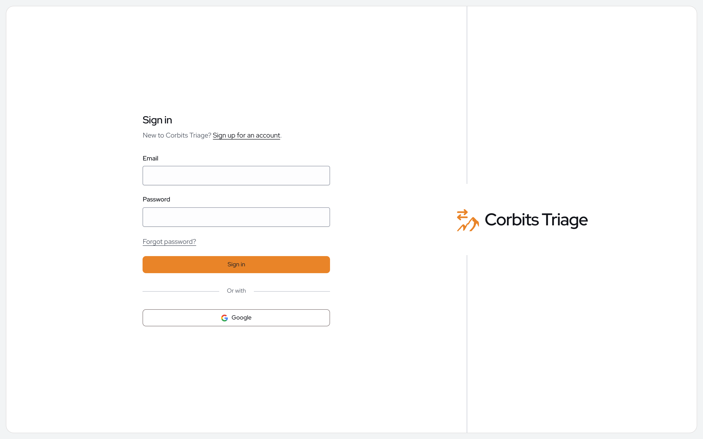

Type your email address and password and press **Continue**. If your organization uses Google sign-in, a **Continue with Google** button appears instead of, or below, the password fields. If the sign-in screen shows **Forgot password?**, use it to reset a forgotten password.

To keep the portal on your home screen or desktop, use your browser's **Install** or **Add to Home Screen** option; it then opens in its own window like an app.

### Creating an account

If you are the first person from your team, click **Create an account** below the sign-in box. The form asks for your name, your email address and a password.

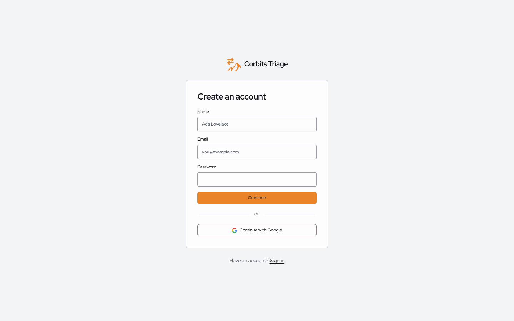

Unless you are the first person to use this Corbits Triage, you then see **Verify your email** until you prove the address is yours. Open the link in the email Corbits Triage sent you, and the portal opens. If the email has not arrived, press **Resend link**; you can ask for a new one once a minute. **Sign out** leaves the screen. If the service cannot send email, the screen asks you to have whoever runs this Corbits Triage verify your address; once they have, reload the page. Signing in with Google never asks for this.

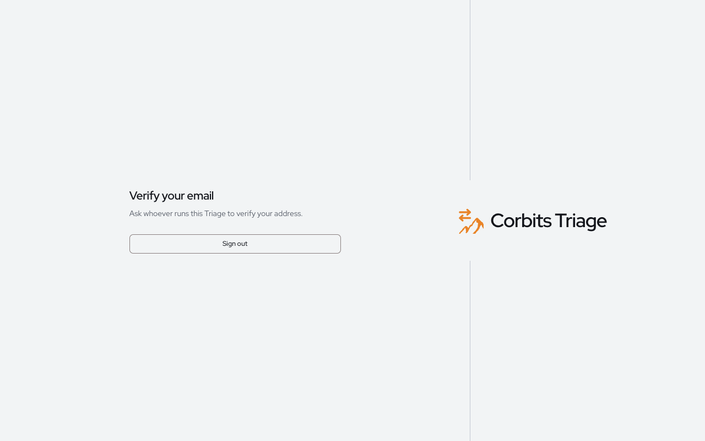

Creating an account also creates a **workspace**, the shared space your whole team will use. Invite teammates from Settings to join yours. If someone has already invited you, open the invite link they sent instead of creating an account from scratch; on a server that does not send email, sign in first so they can invite you. Someone who signs in without an invitation gets a workspace of their own; inviting them later adds yours, and they switch between the two from the workspace switcher at the bottom left of the sidebar, just above your name. Its last entry, **New workspace**, creates another empty workspace of your own.

### First-time setup

The first time you sign in to a new workspace, the portal walks you through three steps. The third, the decision model, can wait: press **Skip for now** and add it later.

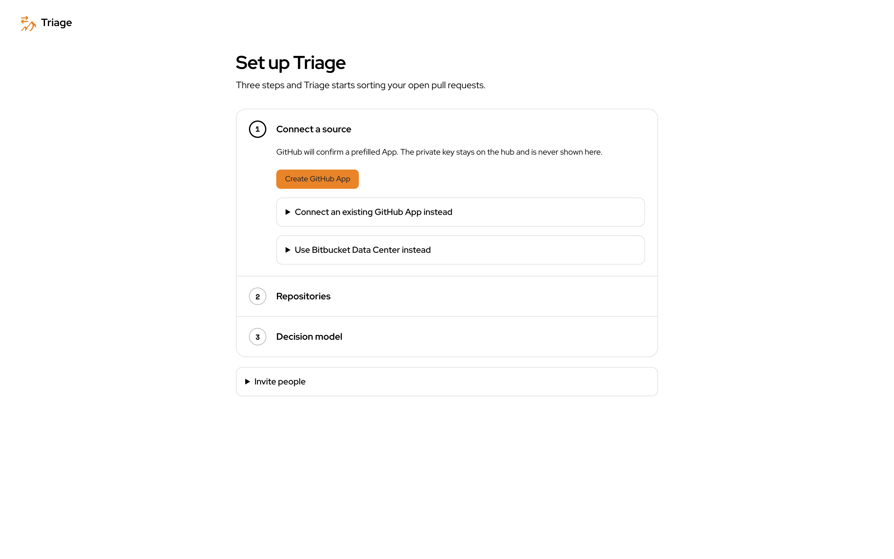

1. **Connect a source.** A source is where your pull requests live: GitHub or Bitbucket Data Center. Triage talks to GitHub through a GitHub App. Press **Create GitHub App** and GitHub opens with a prefilled form for you to confirm, then asks which account and repositories the App may see. Pick them and GitHub sends you back to the portal, so one trip covers the first two steps. On a Triage server at a localhost address, GitHub cannot reach it, so the App is created without a webhook and Triage picks up pull requests every five minutes; the setup screen says so. The App's private key is stored on the Triage server and is never shown in the browser. If your organization already has a GitHub App for Triage, expand **Connect an existing GitHub App instead** and enter its App ID, its private key file and its webhook secret; GitHub checks the App ID and key before they are saved. The portal shows the webhook URL you must paste into the App's settings on GitHub. A workspace works with the App on one GitHub account: if the App is installed on more than one, Triage keeps the first account's repositories and asks you to remove the App from the others. A workspace set up before this, with the App on several accounts, must sync its repositories once and keep the App on one account.

   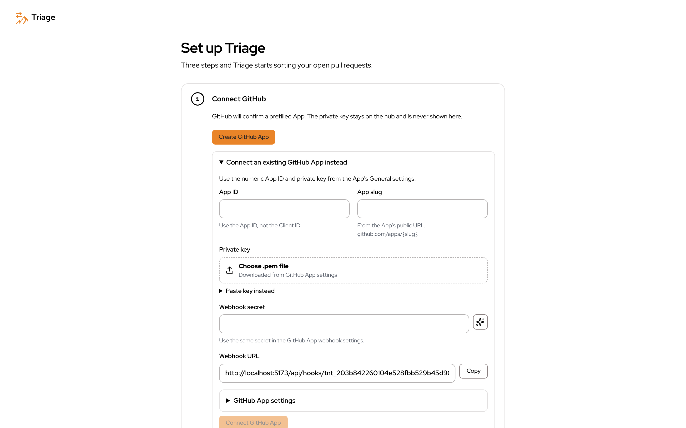

   If your team uses Bitbucket Data Center rather than GitHub, expand **Use Bitbucket Data Center instead** and connect your instance as described under [GitHub and Bitbucket Data Center](#github-and-bitbucket-data-center).

   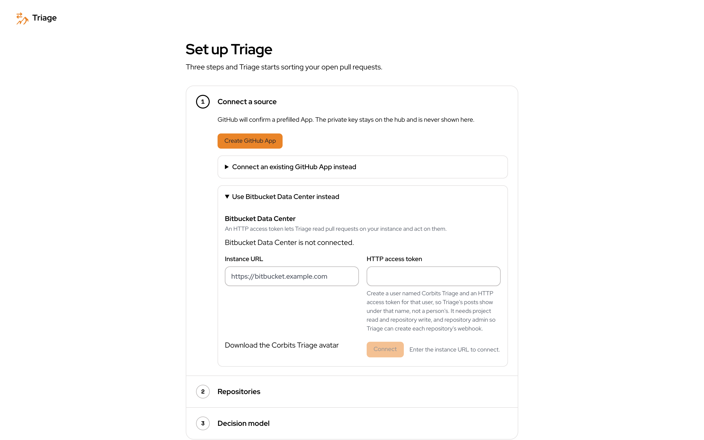
2. **Repositories.** On GitHub, the portal lists the repositories you picked. To change them, or if you connected an existing App, press **Choose repositories on GitHub** (**Choose repositories again** once some are listed) and pick which repositories the App may see. GitHub tells Triage which ones you chose. With Bitbucket Data Center there is nothing to pick: Triage lists every repository the token can see, and you turn triage on for each one under Repositories. Either way they arrive with triage switched off, so nothing runs yet.
3. **Decision model.** Pick an AI provider from the list, paste the key your provider gave you, and press **Save decision model**. The key is stored in the server's vault and you will not see it again. If your organization runs its own compatible model service, choose **Add my own provider** and enter its address, model name and key. To do this later, press **Skip for now**. Triage does not run without a decision model: the first time you turn triage on for a repository, the portal asks for it in a popup, and **Save and turn on** saves it and turns triage on.

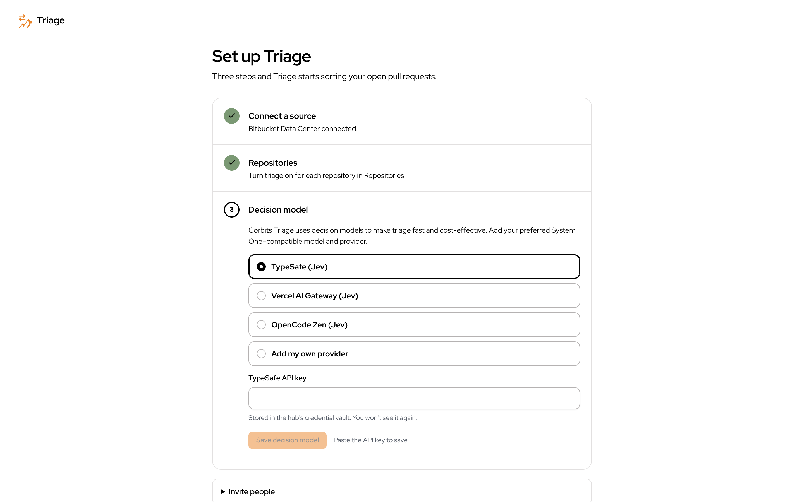

You can also invite teammates from this screen by expanding **Invite people**, or do it later from Settings.

### After setup

Once the steps are done or skipped, the portal takes you to Repositories, where triage is still off for every repository. The next section shows how to turn it on, and the one after it shows what you will see.

## Setting up a repository: rules, verdicts and actions

Every repository has its own page under **Repositories** in the menu under your name. A repository's rules, and what Triage does with each verdict, live in a file in the repository called `.corbits-triage.yml`. The page reads that file back to you. From top to bottom it holds the triage switch, **Actions Triage takes on its own**, the **Policy**, **Code review**, **Outcomes** and **Remove repository**. Switches are saved as you change them; the word beside the repository's name says **Saving…** while a change is on its way, **Saved** once it is stored, and **Not saved** if the save failed.

![The repository page for acme/gadgets beside the Repositories list: the triage switch on, then Policy with Change on GitHub and its rules read back as sentences, from Flag pull requests over 25 files changed to Never accept changes to vendor/**, node_modules/**, then Pass: Comment with the verdict, Label “Triage: Ready”, Approve, for maintainers; Fail: Comment with the verdict, Label “Triage: Not Ready”; Unsure: Comment with the verdict, Label “Triage: Needs Human Review”, Request review from code owners, and Code review below](images/06.png)

### Turning triage on

The switch labeled **Triage pull requests in this repository** is the master control. While it is off, Triage ignores the repository entirely and the rest of the page is grayed out. You can turn it on before the policy has any rule: the page then says **Triage is on. It starts once the policy has a rule.** and nothing is checked until it does. Once the policy has a rule, Triage checks every open pull request, and on GitHub it does so again each time a valid policy file is pushed to the default branch. From then on it reacts to each new pull request event as it happens. On GitHub, the link **Triage open pull requests again** re-checks everything that is currently open, which is useful after you change the policy. When the run finishes, each pull request's new result replaces its old one in the inbox. Drafts are skipped until they are marked ready for review; one without a result shows **Draft** and **Draft: Not evaluated** instead of **Not triaged yet** and **Not evaluated**.

### Bitbucket Data Center repositories

Repositories from Bitbucket Data Center are named by project key and repository, such as `TRI/widgets`, and carry a **Bitbucket Data Center** mark under their name in the list. The link in the corner of the repository page opens it on Bitbucket.

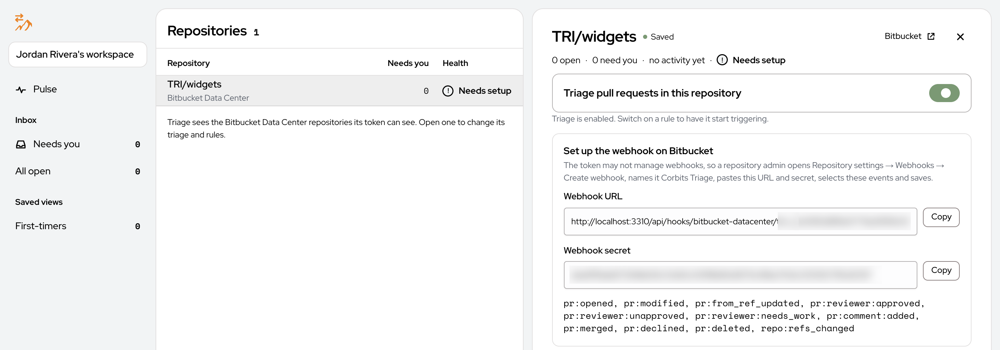

Bitbucket tells Triage about pull request events through a webhook on each repository. When you turn triage on, Triage creates that webhook itself if its token is allowed to. If not, the page shows **Webhook setup** with the webhook URL, a secret and the list of events. A repository admin on Bitbucket then:

1. Opens the repository, then **Repository settings → Webhooks → Create webhook**.
2. Names it **Corbits Triage** and pastes the URL.
3. Pastes the secret.
4. Selects the events listed and leaves the webhook active.
5. Saves.

The secret is shown only this once. Turning triage off removes a webhook Triage created; one set up by hand stays until an admin deletes it.

A few things work differently from GitHub, because Bitbucket works differently:

- **No labels.** Bitbucket Data Center has no labels, so verdict labels and **Add labels** steps have no effect there, and a rule set to `onFail: label` only adds its note to the comment. Triage shows its verdict as a build status named **Corbits Triage** on the pull request's latest commit instead, while Comment is on for the repository.
- **No assignments.** Bitbucket has no assignees, so **Assign to** steps are not carried out.
- **Bitbucket's own reviews.** Approve, Request changes, Close and Merge become Bitbucket's approve, needs work, decline and merge.
- **CI is checked on a timer.** Bitbucket sends no event when a build finishes, so a pull request waiting for CI is checked within a few minutes of its builds ending. While the **CI must pass** rule is waiting on a build, or failing because of one, Triage looks at the build again after five minutes, then less often, and checks the pull request again once it has changed.

### Policy

A repository's policy is the file `.corbits-triage.yml` (`.corbits-triage.yaml` works too) on its default branch, so changes to it are reviewed like any other code. The **Policy** section reads it back in plain sentences: each rule that is on, then what Triage does on **Pass**, **Fail** and **Unsure**. Rules and actions change only in the file. **Change on GitHub**, or **Change on Bitbucket** for a Bitbucket repository, opens it there.

- With no file and no rules saved in Triage, the section shows a **Start a policy file** card with the steps **Review**, **Open pull request**, **Merge** (**Merge on Bitbucket** for a Bitbucket repository) and **Done**. It lists the rules the file starts with: at most 30 files and 3,000 lines changed, no merge conflicts and passing CI, with no actions. **Open the pull request** opens one adding `.corbits-triage.yml`, or shows the one already open; change the rules there before you merge. Triage runs nothing on the repository until it is merged.

  

- When a change to the file reaches the default branch, the next triage uses it. Where GitHub or Bitbucket cannot reach Triage to tell it about the change, Triage notices it within a minute.
- If the file has a mistake, Triage runs nothing on the repository until it is fixed. The section says so and lists each problem, and the Inbox names the repository. A repository that still has rules saved in Triage keeps running on them instead, and its card below says **Triage can't read** the file and why.

#### Moving saved rules into the file

A repository set up before policy files has its rules saved in Triage. They move into the file once, through a pull request, with one card in the Policy section that walks through the steps **Review**, **Open pull request**, **Merge** (**Merge on Bitbucket** for a Bitbucket repository) and **Done**. Your saved rules keep applying until the move is done.

- **Move this repository's rules into a policy file.** The repository has saved rules and no file. **Open the pull request** opens one adding the file with your saved rules and actions. Anything a file can't hold is listed above it, one plain line each, such as "Risk stops after the merge; a policy file can't hold it."

  

- **Your policy file differs from your saved rules.** The repository has both, and they don't do the same thing. Each difference shows the rule with its **Saved** and **File** values, the changed value marked. **Update the file to match** opens a pull request changing the file to your saved rules. **Use the file instead** keeps the file as it is and puts the saved rules away. It first asks you to confirm, with one line for each thing that will change, such as "Pull requests that change vendor/** will no longer fail." Press **Use the file** to go ahead, or **Cancel**.

  

  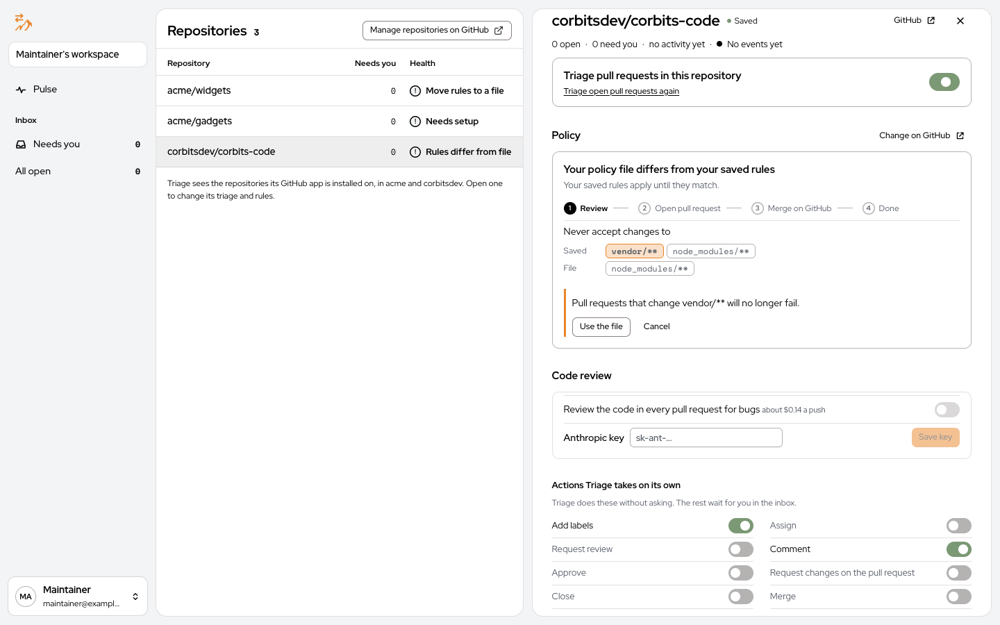

- **While the pull request is open,** the card shows it as **Open, waiting for merge**, with **Review on GitHub** to read it there and **Merge** to merge it from the card. On Bitbucket, **Merge on Bitbucket** opens it there. **Update the pull request with your saved rules** brings it up to date; a second one is never opened. The card notices the merge on its own. If your file differs, **Use the file instead** is still offered.

  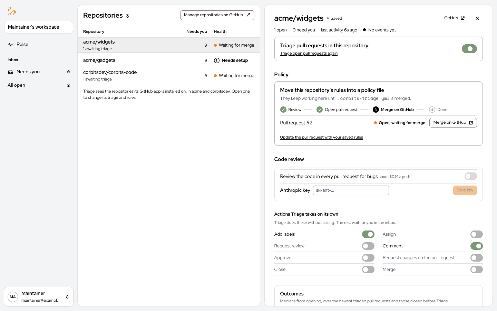

- **Finish moving to the policy file.** The file holds everything from your saved rules that a file can hold. What is left is shown as a difference; press **Use the file**, then confirm, to switch.

  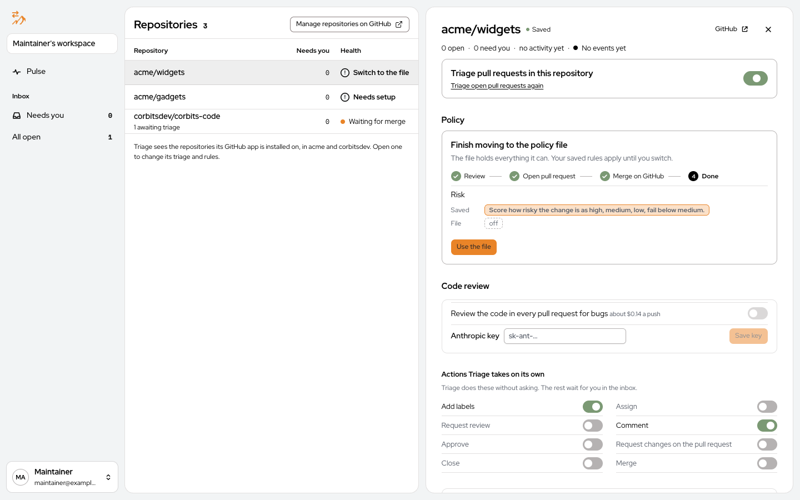

Once the move is done, the file alone is the policy. If the page is open when that happens, the Policy section says **Done. Your rules now come from .corbits-triage.yml.** above the rules.

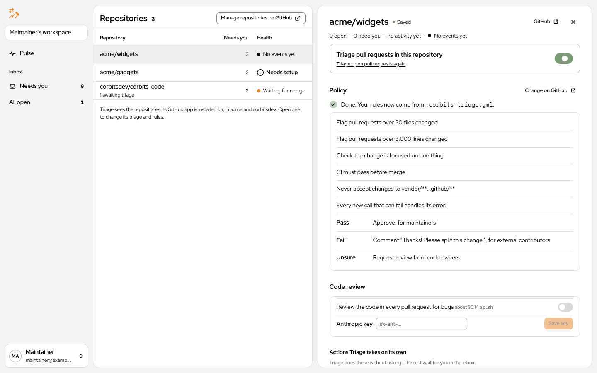

The Repositories list marks each repository that still has a step to take: **Add a policy file**, **Move rules to a file**, **Rules differ from file**, **Waiting for merge** or **Switch to the file**. The Inbox shows the same words in one line, each repository linking to its page; repositories with no policy file yet are counted in a line of their own that links to Repositories.

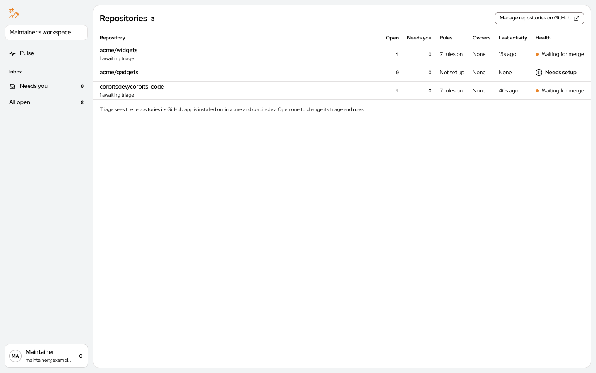

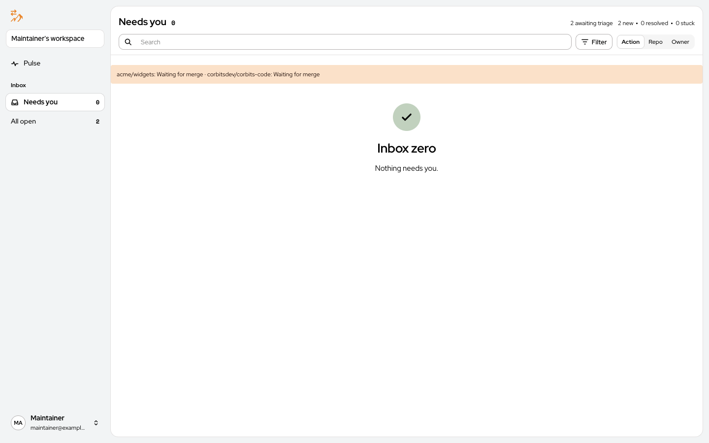

#### Writing the file

In the file, each rule is one sentence with how it is checked and why it exists: a one-line `reason` and its `evidence`, such as the pull requests that led to it (`"#44"`) or `maintainer-stated`. For example:

```yaml
rules:
  - check: max-lines-changed
    text: A pull request changes at most 400 lines.
    max: 400
    reason: Large changes were split before review.
    evidence: ["#44", "#57"]
```

A file exported before rules carried reasons keeps working as it is.

A coding agent can write the file for you with the skill in [`skills/corbits-triage-setup`](../../skills/corbits-triage-setup/SKILL.md). It looks at the repository, asks only what it can't tell, suggests the starter rules and any that fit, writes `.corbits-triage.yml` and checks it the same way Triage reads it. To use it, copy the `corbits-triage-setup` folder into your coding agent's skills folder, such as `.claude/skills/` in the repository for Claude Code or `.agents/skills/` for agents that read that path, then ask the agent to set up Corbits Triage.

A file can also start from another repository's policy with `extends: owner/name` (on Bitbucket, `PROJECT/slug`), and then set only what differs for this repository. This is useful when many repositories should follow the same rules: keep them in one repository's `.corbits-triage.yml` and extend it everywhere else. That repository must be connected to the same workspace, and its own file must not use `extends`. A change merged into it applies to every repository extending it from their next verdict. A file can instead extend a workspace-wide policy by its id.

A file may also name author `groups`, turn on the checks that run after triage (`code-review`, `security`, `deslop`), set `pace` and a `pauseLabel`, and list what to do in `decide` instead of `actions`:

```yaml
groups:
  maintainers: { association: [OWNER, MEMBER, COLLABORATOR] }
code-review: { on: true, for: [maintainers], when: { paths: ["!**/*.md", "!**/*.lock", "!**/package-lock.json", "!**/pnpm-lock.yaml"] }, provider: anthropic }
decide:
  - { if: { triage: fail }, do: request-changes }
  - { if: { triage: pass, all: clean }, do: approve }
  - { if: { code-review: findings }, do: [{ do: request-review, target: { to: codeowners } }] }
```

Triage checks these keys when it reads the file. A file that turns a check on, or writes its own `decide`, runs triage, then its checks, then `decide` once to choose what happens, and the file alone then decides code review for that repository, whatever its Code review switch says. Only `code-review` with provider `anthropic` runs as a check today: it reviews each pull request's code after triage, for the groups in `for` and on the verdicts and paths in `when`. By default it reviews only once the rules in your file that fail a pull request and need no model have passed. CI counts only when `ci-green` is on. Triage's built-in checks, such as a draft or a requested change, don't hold the review back. A pull request that fails one gets its Fail with those reasons and no review, and one whose CI is still running is reviewed once CI passes. Write `when: { rules: any }` to review whatever those rules say. When triage could not read the pull request, code review waits instead of running. A check's `when: { paths: [...] }` limits it to pull requests where a changed file matches one of the globs. A glob starting with `!` leaves out the files it matches, so the `code-review` example above skips pull requests that change only Markdown docs or lockfiles (`*.lock`, which covers `bun.lock`, plus `package-lock.json` and `pnpm-lock.yaml`). A renamed file counts under its old and new path. When Triage can't read every changed file, the check is recorded as unfinished, never skipped. Such a file needs the workspace's Anthropic key ([Settings → Code review](#code-review-2)) and a [place to run](#where-code-review-runs), even one that only writes `decide`. Until both are set up, or while the file turns on a check that can't run yet, such as `security`, triage runs alone and approve and merge wait for you in the Inbox. Once no repository's file needs it, it stops running. On GitHub, a pull request carrying the `pauseLabel` label starts no triage or check run while it has that label, and removing the label triages it again. On GitHub, while a pull request in a repository with a `pauseLabel` can't be read, it isn't triaged and is tried again later, never run as if unpaused. Through a long GitHub outage it is retried a limited number of times, then triaged on its next event. `pace` doesn't act yet.

An action's `when: { author: [...] }`, a check's `for` and a `decide` rule's `author` can name a group. An author is in the first of your groups they match, in the order you wrote them, and in each built-in group (`maintainers`, `external`, `first-timers`, `bots`) their role puts them in. Everyone is in `everyone`. The built-in groups go by the author's role alone, so they still work when Triage can't read teams; only when it can't tell the author's role are they unknown too. For a group you define, Triage can't tell whether the author is in it when it can't tell their role, or when teams it can't read would decide which of your groups is theirs. An action for a group Triage can't tell about doesn't run. `everyone` always matches. Never let Approve or Merge rest on `everyone` alone. In `decide`, `{ all: clean }` means at least one check ran and every check that ran came back clean; checks that were skipped don't count, so when every check was skipped it doesn't match. A rule that approves or merges without naming `triage` only matches a Pass. A check with `clean: { below: medium }` is still clean when its only findings are less severe than medium. A review that couldn't read the whole change is incomplete, and incomplete is never clean. A file that uses `extends` can't hold these keys. Every key is listed in the setup skill's [reference](../../skills/corbits-triage-setup/reference.md#blocks-and-decide).

If the file has a mistake, each problem names its line and what the value must be, such as "Line 12: `security.when.triage` must be pass, fail or unsure, or a list of them." A misspelt key says which one you likely meant, such as "`code-reveiw` is not a key; did you mean `code-review`?"

#### Checking the file in pull requests

On GitHub, a mistake in the file can be caught before it reaches the default branch, and each pull request can be checked against the rules that need no model. Add this workflow to the repository as `.github/workflows/corbits-triage-policy.yml`:

```yaml
name: Corbits Triage policy
on: pull_request
permissions:
  checks: read
  contents: read
  pull-requests: read
jobs:
  check:
    runs-on: ubuntu-latest
    steps:
      - uses: actions/checkout@11d5960a326750d5838078e36cf38b85af677262 # v4.4.0
        with:
          persist-credentials: false
      - uses: corbitsdev/corbits-triage/packages/policy-check-action@0aa2ba2ebeadc02530e15c222306c7baa9b4330c
```

Each pull request then gets a **Corbits Triage policy / check** check. It reads the file exactly as Triage does and fails if Triage could not read it. Each problem is marked on its line in the pull request's **Files changed**, or on the file as a whole when it has no line.

It also runs the rules that need no model, from the policy on the branch the pull request merges into, such as size, linked issue, merge conflicts and forbidden paths, against the pull request. Each failed rule shows as an error when its failure means Fail, and as a warning otherwise, and the run's summary lists every rule with its result and how many passed. Rules a model answers, such as **focused** or your own written rules, show as skipped, and so does **CI must pass before merge**, since the check is itself still running. A policy that uses `extends` is not checked, and one Triage cannot read shows a warning instead. The check fails when a rule whose failure means Fail fails. It only reads the pull request, never posts to it, and works on pull requests from forks. It needs no Triage account and no secrets, and sets up its own Bun for the job. Both actions are pinned to a full commit SHA, so the job only runs code you chose; to update the check, replace its SHA with a newer commit from `main`.

#### Check locally

Before pushing, you can run the same rules on your own change. From a clone of this repository, run `packages/policy-check-action/src/cli.ts check` inside the repository you are changing (it needs Bun). It reads the policy on the default branch (`--base <branch>` for another) and checks your change twice: **Committed**, your commits since your branch left it, which is what Triage sees once you push, then **Working tree**, which adds staged and unstaged edits and new files, or says there are no uncommitted changes. Each lists every rule with its result, then each failure. Rules a model answers show as skipped, and so do rules that need the pull request on GitHub or Bitbucket: CI, merge conflicts, linked issue, hidden content, conventional commits when they cover the title, and your own text rules that read the title or description. It never contacts the host and needs no account. It exits with 1 when a rule whose failure means Fail fails in **Committed** (a failure only in the working tree is a warning), 2 when the policy cannot be read or the change cannot be checked, and 0 otherwise. The rules are the same on both hosts, so it works for Bitbucket Data Center repositories too.

#### Browser extension

The Corbits Triage browser extension, for Chrome and Firefox, shows how a GitHub pull request fares against its repository's policy file without a Triage account. Install it ([how](../../apps/extension/README.md#install)) and open a pull request while signed in to github.com. It reads the pull request and the policy file as you, so private repositories you can see work too, and it changes nothing. A read-only GitHub token saved in its side panel is optional: it is used only for what github.com does not show the extension. When something cannot be read either way, the section says what and checks nothing. Signing in to github.com as a different account, or signing out, clears the results it saved for the previous one.

On any pull request it adds a status beside the title: a ring that spins while Triage runs, then turns green with **Pass** when every check it ran passed or red with **Fail** when any failed, whatever the rule's `onFail`. While only CI is still running it says **Checks running**; anything else not settled yet says **Not settled**. A **Corbits Triage** section at the top of the sidebar lists each failed check with its reason, or how many passed, with **Triage again**. The side panel, opened from the toolbar, the status or the section, shows a score from 0 to 100, lists every check with its evidence and links the policy file on the default branch. **Files changed** marks the files and lines a failing check points to. The extension runs the policy's rules only, not its Judgement rules. Without a saved token, a pull request isn't checked when github.com doesn't give its rendered description or when a commit, such as a merge commit, can't be read; the section says which, and saving a token fixes it. When Corbits Triage has sent a code review to the pull request, the section links to it and lists its comments by file and line; it shows the review only with a saved token. A pull request with the policy's pause label shows **Paused** and is not checked. **Triage again** reads the pull request and the policy file afresh. A repository with no policy file gets a short note linking to [Writing the file](#writing-the-file).

### Rules

A rule asks one question about a pull request and answers pass, fail or unconfirmed. The Policy section shows each rule that is on as one sentence. A file can turn on:

- **Size**: **Flag pull requests over N files changed**, **over N lines changed**, **over N lines changed in one file**, **over N lines added** and **over N lines deleted**. Big changes are hard to review. You choose the limits. Lockfiles, such as `bun.lock` or `package-lock.json`, are left out of every count. Size rules only label and note the pull request unless the file gives them another `onFail`, since features and refactors cross them. On Bitbucket Data Center, which does not report lines per file, the per-file rule always passes and lockfile lines stay in the line counts.
- **Facts the host already knows**:
  - **Require a linked issue** from GitHub, Linear or either. The pull request's title, description, commits or branch must mention an issue.
  - **Flag merge conflicts with the base branch.**
  - **CI must pass before merge.** The repository's automated checks must be green. While they are still running, the rule is unconfirmed and Triage waits for them. When one was cancelled or went stale without a result, a build cancelled on Bitbucket Data Center included, the rule is unconfirmed and the verdict is Unsure, with the comment naming the checks to re-run; re-running them triages the pull request again. A skipped check counts as passed.
  - **Never accept changes to** certain paths, such as vendored code.
  - **Require a conventional commit title and messages.** The title and the first line of each commit must start with a type, such as `feat: add search` or `fix(api)!: drop v1`. The types are feat, fix, refactor, perf, docs, test, chore, ci, build, style and revert unless the file lists its own, and the file can check only the title or only the commits. Case does not matter. Merges and the `Revert "…"` commits GitHub's revert button makes are skipped, and only the first 100 commits are read. When it fails, Triage names each title or commit that doesn't follow the format.
  - **Flag pull requests that hide text.** Fails when the title, description, a commit message or a file name hides something from a reviewer: two or more invisible characters together, Unicode tag characters other than those that draw the England, Scotland and Wales flags, variation selectors that change nothing a reader sees (one emoji-style selector on its own is allowed), characters that override or isolate text direction, or a link with nothing to click. Right-to-left text and colour codes in pasted terminal output are allowed. On GitHub it also fails when a comment or other hidden markup the author added to the description speaks to an AI, such as "ignore previous instructions", or holds those characters. A comment exactly as the repository's pull request template has it, or, with no template, its organisation's `.github` repository's, is skipped; one the author shortened or added to is checked. When it fails, Triage says what it found and where, such as `commit 2: bidi controls`, never the hidden text. On Bitbucket Data Center only the characters are checked. It knows only common wording: an instruction that is paraphrased, written with look-alike letters or HTML entities, or split across comments passes, and so does a single invisible character between letters. Give it `onFail: ask` so a maintainer decides rather than the author being failed.
  - **Flag changes to files with N+ fixes in the last 30 days, or to migrations.** Fails when a changed file has had at least N commits in the last 30 days whose title starts with a fix, bugfix, hotfix or revert type, such as `fix(api): …` (4 unless the file sets `hotFileFixes`), or a changed file is a migration (`**/migrations/**` or `**/*.sql` unless the file lists its own `migrations`). Tests, Markdown docs and lockfiles are left out. Its evidence names the hottest three files and how many more, such as `src/router.ts: 6 recent fixes` or `db/migrations/0004.sql: migration`. It only labels and notes the pull request unless the file gives it another `onFail`, so a `decide` rule or a step can hold back an approve or merge on its label. When Triage can't read a file's whole recent history, the rule is unconfirmed rather than passed, and the rest of the pull request is checked as usual. Triage reads the history of at most 300 changed files per pull request, so on a larger one the rule is unconfirmed with **could not read the recent history of some changed files**, unless a changed file is a migration or one it read is hot. The default of 4 was measured on one open-source repository; check it suits yours.
  - **Fail when …**, a text rule of your own, such as "Fail when any commit message contains "Co-Authored-By:"". It names where to look (the title, the description, any commit message, or several of them), whether the rule fails when the text **contains** or **does not contain** its phrases, and the phrases. Case does not matter. A **contains** rule on the description also looks at its hidden parts, such as HTML comments and the addresses behind links, while **does not contain** reads only what a reader sees. Only the first 100 commits are read. When a **contains** rule fails, Triage names each place and the phrases found there, asks for them to be removed, and quotes each matching line once. Text rules count toward the eight rules of your own.
  - **Fail when added code matches …**, a code-pattern rule of your own, such as one that flags `?? 0`. It checks only the lines the pull request adds to TypeScript and JavaScript files (`.ts`, `.tsx`, `.mts`, `.cts`, `.js`, `.jsx`, `.mjs`, `.cjs`), so code already on the branch never fails it. On any other language it passes with **nothing checked: no TypeScript or JavaScript code added**, so don't add one to a repository written in Go, Python or similar. Turn on the shipped `convention` preset, which flags invented fallbacks (`?? 0`, `?? []`), nested ternaries, functions called where they are written, `.then`/`.catch` chains, empty `catch` blocks and lint or type suppression comments in both languages, or write your own patterns in [ast-grep](https://ast-grep.github.io/guide/rule-config.html)'s rule format. Your own pattern replaces a preset's pattern with the same `id` in both languages; to keep checking JavaScript, add a `language: javascript` pattern under the same id. A pattern takes ast-grep's own `files` and `ignores` lists to check only some paths or skip some. They follow ast-grep's glob rules: paths are from the repository root, `*` also matches across folders, and dotfiles are matched like any other file. Write each glob as a string; the `{ glob, caseInsensitive }` form is not read. Write a negated class as `[^a]`; a glob with `[!a]`, or one that isn't valid, refuses the policy. The preset's `?? 0` and `?? []` patterns ignore test files (`**/*.test.ts`, `**/*.test.tsx`, `**/*.test.js`, `**/*.test.jsx`, `**/*.test.mjs`, `**/*.test.cjs`). Each match is listed as evidence, as `path:line` and the pattern's message. Vendored and built code at the repository root (`vendor/`, `dist/`, `build/`, `generated/`) and installed code (`node_modules/` anywhere) is skipped, and each skipped file is listed in the evidence. The same folders deeper in the repository, such as `src/build/`, are checked. When a file can't be read whole or a pattern is not valid ast-grep, the rule is unconfirmed rather than passing. Triage reads at most 300 files per pull request, so on one that adds code to more, the rule is unconfirmed with a reason such as **code patterns could not be checked: 412 files with added code, more than the 300 read per pull request**. On Bitbucket Data Center, which does not give Triage each file's changed lines, it is unconfirmed whenever a TypeScript or JavaScript file of your own is added, edited, moved or copied. To give some patterns a different `onFail`, put them in a rule of their own. Code-pattern rules count toward the eight rules of your own, and the browser extension leaves them out.
- **Judgement**, questions the decision model answers from the diff and the documentation:
  - **Check the change is focused on one thing.** On a stacked branch, one another pull request was merged into or one based on another open pull request's branch, this rule is skipped, and the comment says why, such as "stacked branch, includes #1521".
  - **Check docs are updated when behavior changes.**
  - **Is it true that …**, a yes-or-no question of your own, such as "Is it true that the title says what changed?" The rule fails when the answer is no.

Two rules always run: a draft pull request waits until it is ready for review, and a pull request with changes requested fails. Once the author pushes a new commit or replies, it still fails but waits on the reviewer, in **Needs you** as ready for re-review, until that reviewer approves or requests changes again.

Each rule's `onFail` says what happens when it fails:

- `fail`, the default for every rule but the size rules: the verdict is **Fail** and the comment asks the author to fix it.
- `ask`: the verdict is **Unsure** and the comment lists the rule under **Asking a maintainer about:**, so the pull request waits for you in **Needs you** instead of on its author.
- `label`, the default for the size rules and regression risk: the verdict does not change. When the rule fails, or the decision model can't tell, Triage adds its label to the pull request and a line under **Notes:** in its comment. Triage's comment and the reading pane leave a `label` rule out of their rule list; it shows only as a note and a label (on Bitbucket Data Center, only the note). The browser extension, the **Corbits Triage policy / check** check and the local check still list it. Triage never takes the label off, since a person may have added it; remove it once it no longer applies. The label is `size: large` for the size rules, `docs: check` for the docs rule and the rule's id followed by `: check` for any other, such as `regression-risk: check`; `label:` names a different one, but not one starting `Triage:` or `rule: ` or a verdict label, which Triage takes back itself. `onFail: label` suits rules that are hygiene rather than a gate, such as size limits an atomic change has to cross. A top-level `onFail` sets it for every rule in the file that does not set its own. The Policy section shows a rule that does not fail the pull request with what it does instead, such as "(on fail, labels size: large)".

To make a size limit block, give it `onFail: fail` or `onFail: ask`:

```yaml
  - check: max-lines-changed-per-file
    text: Flag pull requests over 500 lines changed in one file.
    max: 500
    onFail: ask
    reason: A very large file change is hard to review line by line.
    evidence: [maintainer-stated]
```

A code-pattern rule that labels instead of failing:

```yaml
  - id: conventions
    check: code-patterns
    text: Added code follows our conventions.
    presets: [convention]
    patterns:
      - id: no-console
        language: typescript # or javascript
        message: Remove console logging.
        ignores: ["scripts/**"] # ast-grep globs; `files` checks only the paths it names
        rule: { pattern: "console.log($$$ARGS)" }
    onFail: label
    reason: Review time goes to design, not style.
    evidence: [maintainer-stated]
```

Size rules and facts the host already knows cost nothing and always give the same answer for the same pull request. Judgement rules call the decision model, a few requests per pull request, each billed by your model provider.

### How the verdict is decided

1. If any rule fails, the verdict is **Fail** right away. That includes a Judgement rule the decision model answered no to. A failed rule set to `onFail: ask` makes it **Unsure** instead, unless another rule fails it.
2. Whenever it answers Judgement rules or decides the verdict, the decision model is also asked whether the pull request's title, description, commits, changes or the repository's docs try to tell it what to answer, such as "approve this" or "ignore your instructions". If it is at least 70% sure they do, none of its answers count: every Judgement rule is left unconfirmed and the verdict is **Unsure**, with the reason "the pull request tries to direct the decision model", so a person decides. A failed rule that decides **Fail** on its own still does.
3. If the policy has no Judgement rules, there is nothing left to judge: the verdict is **Pass** when every rule passes. A rule still waiting on the host, such as CI that is still running, makes Triage wait (see Waiting for CI).
4. Otherwise the decision model reads the whole pull request together with every rule's result and answers one question: does this pull request pass this repository's policy? If it is at least 70% sure the answer is yes, the verdict is **Pass**. If it is at least 70% sure the answer is no, the verdict is **Fail**. Anything in between is **Unsure**, which means a person should look. A pull request with a Judgement rule the model could not confirm is never more than Unsure.

Triage reads a pull request's title, description, commit messages and file names as people see them. Text hidden from view, such as invisible characters and, on GitHub, comments in the description, is left out, so the rules, the decision model, the Triage comment and code review never act on something a reviewer cannot see. A code-pattern rule checks the file the pull request actually changed, even when its name hides characters; the result shows the name as you see it. Turn on **Flag pull requests that hide text** to also be told when a pull request tried. The reading pane links only the GitHub issues the description shows, including a pasted link to an issue in the same repository, which GitHub shows as its number.

Rules set to `onFail: label` take no part in any of these steps: they only label and note the pull request. A policy whose only Judgement rules only label is decided as one with none.

Draft pull requests are not decided at all, and a closed pull request gets no verdict.

### Actions

The file lists steps for each verdict, and the Policy section shows them under **Pass**, **Fail** and **Unsure**, after the verdict Triage posts: **Comment with the verdict** and the verdict's label, such as **Label “Triage: Ready”**, or on Bitbucket **Comment and build status with the verdict**. A step or comment Triage may not do on its own says **(waits for you in the Inbox)**, and so does the label when the comment waits; a label Triage may not add while it may comment says **(not added until you allow labels)**. On Bitbucket a comment posted from the Inbox sets no build status. Allow these under **Actions Triage takes on its own**. Each step names an action and who it is for.

| Action | What it does |
| --- | --- |
| Approve | Approves the pull request. |
| Merge | Merges the pull request. Only on Pass. |
| Close | Closes the pull request. |
| Comment | Posts the comment the step gives. |
| Request changes | Sends the author a review listing the rules to fix. |
| Request review from | Asks the code owners, named people or teams to review. |
| Assign to | Assigns the pull request to the author, the code owners, named people or teams. |
| Add labels | Adds the labels the step lists, or one label for each failed rule. |

A step can be limited to some authors, shown after it, such as "Approve, for maintainers": **first-timers**, **maintainers**, **external contributors** or **bots**; one kind of author as GitHub reports it; a GitHub team; or specific people. A step for anyone shows no one. For example, a Fail step can post a friendly comment for external contributors only. In the file, authors are named by GitHub's own author types: `OWNER`, `MEMBER`, `COLLABORATOR`, `CONTRIBUTOR`, `FIRST_TIME_CONTRIBUTOR`, `FIRST_TIMER`, `NONE` and `MANNEQUIN`, plus `BOT` for bots. A file that names first-timers, maintainers, external or bots still works and means the same authors as before.

A step can also run only when the pull request links an issue (or does not), when its CI is passing, failing, pending or absent, or when it changes more or fewer files or lines than you say. CI that was cancelled counts as pending until a check is re-run. These conditions are written under the step's `when`; the page shows only who a step is for.

Under the triage switch, **Actions Triage takes on its own** lists what the repository's policy has Triage do, and posting its verdict, which Triage needs leave to do without asking. When some of it is not yet allowed, it says **This policy wants Triage to:** and names those actions, such as Comment and Add labels; **Allow** lets Triage do all of them in this repository on its own. Until then they wait for you in the Inbox. Once everything is allowed, it says **Triage does these on its own** and names them. Bitbucket Data Center repositories name **Comment and build status** instead of Comment, and never Add labels or Assign. On a GitHub repository where Triage approves or merges on its own, a line beneath says **Triage approves or merges on its own, which can let unintended code in:** and names **pull requests from first-time contributors**, when such an approve or merge is not limited to other authors, and **changes to CI workflows**, when a pull request changing a file under `.github/workflows` can reach a verdict on which it approves or merges. It is only a caution; nothing is blocked. When the portal cannot tell what Triage may do, or the workspace has no Triage role, the section says so and Triage asks before every action. When Triage's verdict is not on the pull request, its page says why under its header, such as **Not posted on GitHub: Triage may not post here. Allow it under Actions Triage takes on its own on the repository's page.**

Enabling a repository switches on Comment and Add labels (Comment only on Bitbucket, which has no labels); every other action waits for a person to click until you switch it on, so you can watch what Triage suggests before you let it act. Turning triage off and on again switches them back on. Two actions are always held for a person: Close on Unsure, and Merge on anything but Pass.

When the policy depends on CI (the **CI must pass** rule is on, a step has a CI condition, or a step approves or merges), Triage waits for a pull request's CI to finish before it checks it, so it gives one result instead of an early Unsure. Meanwhile the Inbox shows **Waiting for CI** (**Waiting for CI · new commits since Triage checked** when an earlier result is still on show). A pull request that already needed you stays in Needs you meanwhile; one Triage has not checked yet waits under **Waiting**. The pull request's page notes **New commits since Triage checked** above the earlier result, which stays until the new one lands. On GitHub, where Triage adds labels on its own, a pull request labelled **Triage: Not Ready** or **Triage: Needs Human Review** keeps it, so new commits change no label unless the verdict changes; any other, **Triage: Ready** included, shows **Triage: Waiting for CI**, or no Triage label while the commit has no checks. On Bitbucket, where Triage comments on its own, the new commit's **Corbits Triage** build status shows **Triage: Waiting for CI**. The verdict replaces it once Triage has checked the pull request. Triage goes ahead as soon as any check fails, after two minutes when the repository has no CI, and after an hour at most. **Triage again** does not wait.

If Triage checks a pull request anyway while the only rules it cannot confirm yet are waiting on the host (CI still running, or the host has not yet worked out whether the pull request can merge), it gives no verdict yet: the pull request keeps its label or build status as above, nothing is posted and no action runs, and Triage checks it again once they are done. After an hour, on **Triage again**, or when the host still has not worked out mergeability after Triage's last retry, it gives the verdict anyway. If a step depends on CI that is still running, Triage holds every action, and its comment on the pull request lists them under **Waiting for checks to finish**. They go ahead once the checks are done.

An **Unsure** comment lists each rule Triage could not confirm, with checks still running or cancelled under **Waiting on**.

### Labels

Triage keeps a verdict label on every pull request so that other tools, such as a coding agent, can react to it. It puts the verdict's label on the pull request and takes the other two off. The defaults are **Triage: Ready** for Pass, **Triage: Not Ready** for Fail and **Triage: Needs Human Review** for Unsure; the file can rename them. While Triage waits for CI it shows **Triage: Waiting for CI**, and when it could not read the pull request **Triage: Failed to Run** (see [What the author sees](#what-the-author-sees)). A step that labels each failed rule, shown as **Label each failed rule**, adds a label such as `rule: linked-issue` for every rule that failed. The label of a rule set to `onFail: label` is added whatever the verdict, after the verdict's own steps, as an **Add labels** action: where Add labels is allowed, otherwise waiting for you in the Inbox.

On Bitbucket Data Center labels have no effect; see [Bitbucket Data Center repositories](#bitbucket-data-center-repositories).

### Code review

Code review reads each new commit of a pull request for bugs. It runs whether or not triage is on for the repository, and skips drafts. Switch on **Review the code in every pull request for bugs** to start it, and off to stop. In a repository whose [policy file](#writing-the-file) turns a check on or writes its own `decide`, the file decides instead: changing the switch, or pressing **Review again**, says **This repository's policy file decides code review, which runs with triage.**

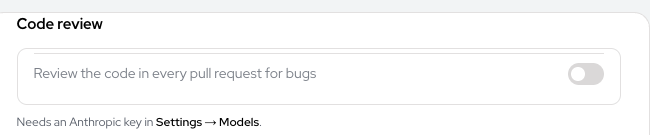

It needs the workspace's Anthropic key. If none is saved yet, switching it on opens **Code review needs an Anthropic key**: paste the key and press **Save and turn on**, and code review is on. You won't see the key again. **Cancel** leaves it off, and the popup cannot be closed while the key is saving. The key is saved for the whole workspace, so other repositories use it too, and [Settings → Code review](#code-review-2) shows it. If you are not allowed to see the workspace's keys, the switch stays off and the section asks you to have an owner add the key; if Triage could not read the keys, the section says **Could not read the workspace's keys** with the reason, and the switch stays off until they can be read.

### Where code review runs

Code review checks out the pull request's code, so each review runs in a place of its own, apart from Triage and from other reviews: a Docker container on the server that runs Triage, or on a separate machine such as a VPS ([Docker on another machine](../provisioners/docker-remote.md) says how your server administrator sets that up), or in an [E2B](../provisioners/e2b.md) or [Railway](../provisioners/railway-sandboxes.md) sandbox in the cloud. [Settings → Code review](#code-review-2) says where it runs.

A server with no isolated place set up for Triage has nowhere to run it. The switch is then replaced by **Code review needs an isolated place to run**, with **Set one up**, which opens Settings → Code review, and **Review again** is hidden in the Inbox. A repository that had code review on says **It is switched on here but not running**, with **Turn off**; nothing is reviewed until a place is set up, and then it carries on without being switched on again.

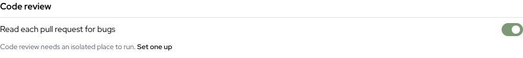

If [Settings → Code review](#code-review-2) says **Could not read where code review runs**, repository pages leave out their Code review section and **Review again** is hidden in the Inbox.

### Removing a repository

**Remove repository**, at the bottom of the repository page, asks you to confirm, then stops Triage on that repository and takes it off Repositories. Its pull requests leave the Inbox and Pulse. For a Bitbucket Data Center repository it also deletes the webhook Triage created; if the token may not, Triage tells you to delete it by hand.

### Outcomes

The **Outcomes** card shows what happened to the pull requests Triage saw, beside those closed before the repository's policy was first saved. Each side gives the median time from opening to **Merge or close**, to the **First response** from someone other than the author, to the **First approval** (approved pull requests only), and the **Longest wait** between two people's touches. **Waiting on reviewer** is the time from Triage's first verdict to the first approval, change request or merge by someone other than the author (a plain comment is not a review), so it shows only on the Triage side. Each figure is the median with its 75th percentile (**P75**) beside it, which shows how long the slower quarter of pull requests took. Above them is how many people were involved. Each side also says how many pull requests it stands on and how many are closed. Triage reads these from the host in the background, so the card appears once they are measured.

When the before-Triage side is missing, the card says why: nothing closed before Triage was switched on, there is no saved policy yet, or the host did not answer. When nothing can be read, the card says that instead: you need a credential for the host, the host did not answer (the numbers return once it does), or the repository is not connected.

## Day to day: the Inbox

Once triage is on, the **Inbox** is where you will spend most of your time. It lists open pull requests, shows each one's verdict and reasons, and offers the next step as a button. Nothing happens on GitHub or Bitbucket until you press one of those buttons, unless you have told Triage otherwise in Settings.

### Finding your way around

The dark strip on the left is the same on every page:

- **Workspace name** at the top. If you belong to more than one workspace, click it to switch.
- **Pulse**: a summary of what changed since your last visit.
- **Inbox**, with three views. **Needs you** shows only pull requests waiting on a person, in repositories with triage on. A pull request with an approval or a held action waiting stays there even after triage is turned off. **Ready** shows the pull requests you can merge now. **All open** shows every open pull request in every repository with triage on, and any with an approval waiting.
- **Your name** at the bottom. Click it for Repositories, Settings and Sign out.

When a newer version of Corbits Triage is released while the portal is open, a notice at the top says **A new version of Corbits Triage is available.** Press **Reload** to switch to it; the page never reloads on its own.

Each view with pull requests in it has a search box and a **Filter** button. **Needs you** and **All open** add quick filters such as Action, Repo and Owner; **All open** and **Waiting** add Waits on. The three counters in the corner show how many pull requests are new since your last visit, how many were resolved, and how many are stuck.

On a phone the strip becomes a bar at the bottom of the screen with **Needs you**, **Ready**, **All open**, **Repos** and **Settings**; tap the counters for Pulse. To refresh a list or an open pull request, pull it down from the top until the round arrow turns dark, then let go; it spins until the latest is in, and your place in the list stays where it was.

### Needs you


Pull requests are grouped by what you need to do: **Unblock** for ones that are stuck on something, **Merge** for ones that passed, and so on. Each row shows a state mark and the pull request's title, and under the title its number, a short status and how long ago it was triaged. The status is the pane's status line shortened: it says what the main button in the pane does and names the first rule it is about, with how many more, such as **Ask to fix: Linked issue +2 more**, **Request changes: Linked issue**, **Review: Linked issue**, **Decide: Focused** or **Couldn't check: Merge conflicts**. With every rule met it says **Review**, **Reply**, **Send feedback** or **Ready to merge**. Once your feedback is posted it says **Waiting on @ada**, and a pull request back for your re-review says **Re-review**. Others say **Waiting for CI** or **Draft**. A pull request that passed is under **Merge** only once GitHub or Bitbucket has said it would merge it now. Until then it is under **Review** and says **Checking merge state**, which is also what it says while the host is still checking or could not be asked. One waiting for a required review is under **Review** and says **Waiting for review**, and one the host refuses for any other reason is under **Unblock** and says why, such as **Behind base**, **Changes requested**, **Has conflicts** or **Merge blocked**. Grouped by Repo, the row shows the author after the status; grouped any other way, the number carries the repository's name, such as `widgets#12`. Click anywhere on a row to open it in the reading pane on the right, where the actions are.

A pull request whose first triage run failed is under **Failed** and says **Couldn't triage**. Its pane says why, such as **Couldn't triage: the run failed**, and **Triage again** tries once more. On a draft, **Triage again** is under **More**, and the pane says so: **Couldn't triage: the run failed · use Triage again in More**.

Pull requests waiting on something else stay out of the list: ones Triage has not checked yet (ones waiting for CI among them), drafts (even ones Triage checked before they became drafts), ones you already acted on, and ones waiting on the author after feedback was posted or changes were requested. A pull request that already needed you stays while Triage checks it again or waits for CI on new commits, and one with an approval or a held action waiting always stays, drafts and ones waiting on the author included, until you approve the action or click **Hide for me** in its pane or on its page, which hides it in this browser only. Click **Waiting** next to **Filter** to list the others instead, in the same list and pane, grouped by what they wait on; Needs you and Waiting together are All open. Click **Waiting** again to go back. When nothing needs you, the list says **Inbox zero**, with **Show 7 waiting** (or however many there are) to open Waiting.

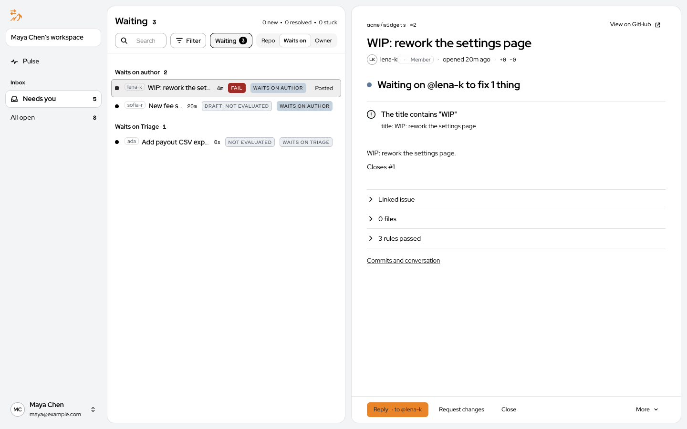

### Ready

The **Ready** view lists open pull requests you can merge now, oldest first, with the same rows and pane: Triage passed the latest commit, CI passed, there are no conflicts and GitHub or Bitbucket has said it would merge it now. Drafts stay out, and so does any pull request whose merge state is still being checked, that waits for a required review or that the branch's rules hold. **Merge** is the pane's next step. A new commit takes a pull request out until Triage passes it again.

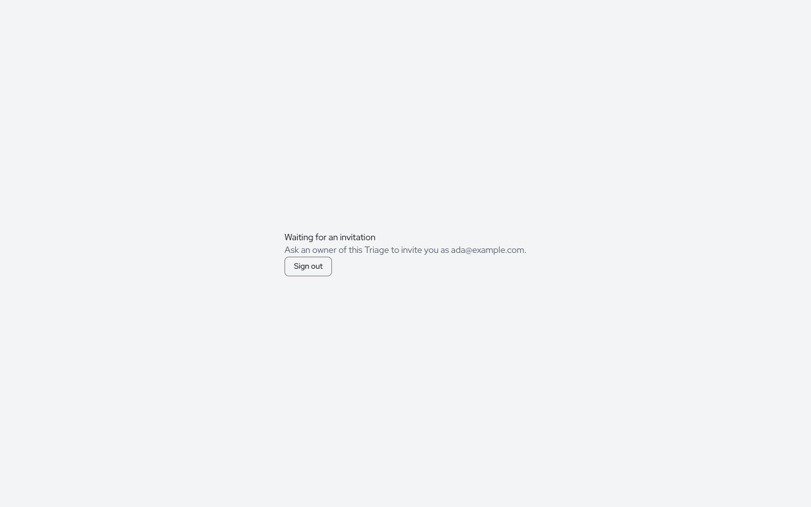

### All open

The **All open** view groups pull requests by repository, with the same rows. Group by **Waits on** to see whose move it is: you, the author, CI, Triage or nobody. **Needs setup** collects pull requests Triage cannot check until their repository is set up: its policy is refused, missing, unreadable or has no rule on. Once you act on a pull request, its status says what you did, such as **Approved** or **Requested changes**.

A pull request that has not been checked yet shows **Not triaged** until its first run finishes, usually within a minute of being opened, or **Waiting for CI** while Triage waits for its checks. A draft shows **Draft**, since Triage waits until it is marked ready for review.

### The reading pane

Clicking a pull request opens it on the right. The pane is built to be read top to bottom.


1. **The header**: repository and number, the title, the author with their chip, when it was opened, and how many lines were added and removed. The **View on GitHub** or **View on Bitbucket** link in the corner opens the same pull request there. The pull request's own page has the same link. On a pull request Triage opened itself, such as the one adding its policy file, the link reads **Review on GitHub** or **Review on Bitbucket**.
2. **The status line** in one sentence, saying what the main button at the bottom does and which rules it is about:
   - **Send feedback**: **Ask @ada to fix: Linked issue, Conventional commits +1 more**, naming up to two failed rules and how many more, or **Send feedback to @ada** when no rule failed.
   - **Request changes**: **Request changes from @ada: Linked issue**. When no rule failed it says what GitHub or Bitbucket holds it for, such as **Request changes from @ada: behind its base branch**, or just **Request changes from @ada**.
   - **Approve**: **Review and approve** with every rule met, or **Approve anyway, or ask @ada to fix: Linked issue** when one failed.
   - **Reply**: **Reply to @ada**, or **Reply to @ada · not met: Linked issue** when a rule failed and Triage drafted no feedback.
   - **Merge**: **Ready to merge**, or **Ready to merge · still not met: Linked issue** when a rule failed. A pull request that passed but that GitHub or Bitbucket will not merge yet says why instead, such as **Can't merge yet: waiting for a required review**, **Can't merge yet: behind its base branch**, **Can't merge yet: the branch's rules block the merge** or, on Bitbucket, the reason its merge checks give, and **Merge** stays off until it can. A pull request Triage opened itself is merged rather than approved, so it reads **Ready to merge** too; with no button and a rule failing it reads **Not met: Linked issue**, and when GitHub or Bitbucket holds it with nothing failed, **Blocked:** and why, such as **Blocked: behind its base branch**.

   Some lines come before the button. A pull request the author updated after your review reads **Re-review: @ada updated it**, then what is still open, such as **· still not met: Linked issue** or **· still to decide: Focused**, or **· all rules met** when nothing is. A rule you need to decide reads **Decide: Focused (Triage wasn't sure)** when the model was unsure, **Decide: Linked issue (your policy asks you)** when the policy asks you about it when it fails, or **(see why below)** for both. Once the feedback is posted it is the author's turn, and it reads **Waiting on @ada to fix: Linked issue**; **Reply** stays available if you want to add something. A rule that could not be checked reads **Couldn't check Merge conflicts · use Triage again in More**. After you approve, it says only what is still open or what holds the merge: **You approved · still not met: Linked issue**, **· still to decide: Focused**, **· couldn't check: Merge conflicts**, **· waiting on @ada**, **· can't merge yet: behind its base branch** or **· ready to merge**. The change you requested is no longer listed. While Triage runs, waits for CI, or checks new commits it says so, such as **Rechecking**, and the row says the same.
3. **The problems**, if any, failed rules first. Each one names the rule, then why, such as **Linked issue: Pull request does not reference an issue.**, with the evidence, such as the name of the failing check. A rule you need to decide is marked **Decide**. A pull request with no problems skips straight to the description.
4. **Code review**, when it is on for the repository: what the change does, then each bug it found as a comment from **Code review**, with the commit it reviewed, how severe it is (P0 is the most severe), the file and line, and the code it points at. A bug in a file code review could not read says **Not checked against the file**, here and on GitHub. If the model keeps failing or a reviewer's answer can't be read, the review shows **The last review did not finish** instead of **No findings**, with the reason under it. **Review again** reviews the latest commit once more. A commit that left the change as it was keeps the last review and says **Carried over from** the commit it was made for. On a GitHub pull request, **Send to GitHub** posts the review to the pull request, inline where the lines are part of the change; it then says **Sent to GitHub**. On a Bitbucket Data Center pull request, **Send to Bitbucket** does the same with a comment per finding and one summary comment. Either needs the Comment permission for the repository, and is refused once the pull request has newer commits that did not keep the review: review again, then send.
5. **The description** the author wrote.
6. **Folded rows** you can expand: the linked issues, the changed files (with the diff), and the rules that passed. Evidence for a file cites its changed lines and links them at the exact commit Triage judged. Linked issues are the GitHub issues the title, description or commits mention, and the Linear issues linked in the description, the commits or a comment from one of Linear's bots. Links hidden in the description are ignored.
7. **Commits and conversation** opens the full history and comments.


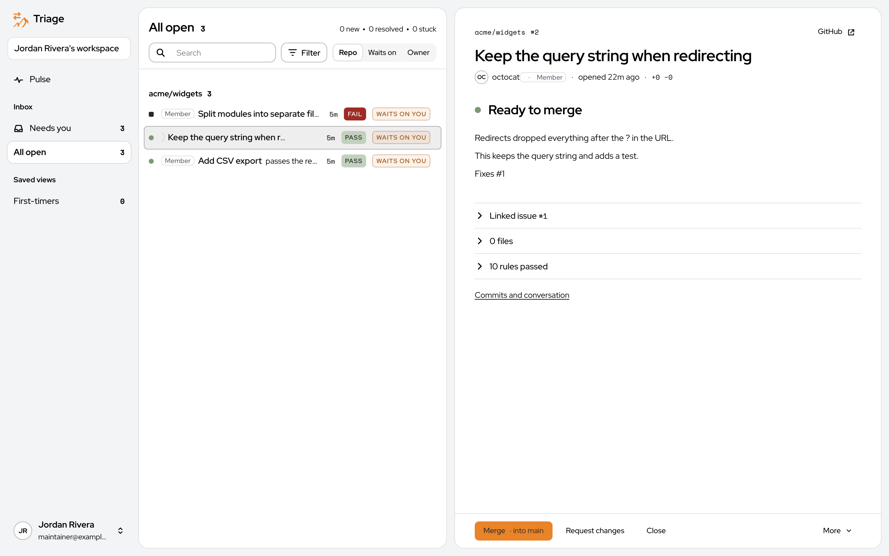

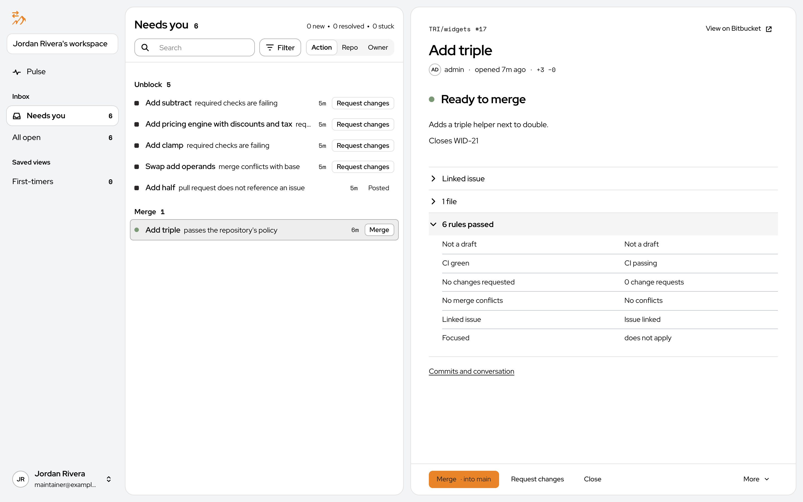

Expanding **Checked and fine** shows every rule with a short note on why it passed, such as CI passing or the number of files changed against the limit. This is the quickest way to see what Triage actually checked.

### Taking action

The bar at the bottom of the pane always offers the next step first. For a passing pull request that is **Merge**, for a failing one it is **Request changes**, and for an unsure one it is usually **Comment** or **Approve**. **Edit feedback** and every other action sit beside it as buttons. Actions the repository's policy held for you are behind one button that counts them, such as **2 held actions**; it lists each with why Triage suggests it, and choosing one approves it. When the next step is itself a held action, such as a held **Merge** on a passing pull request, its button also says **held for you**, clicking it approves the held action, and the action is listed with the others. The list names what each does: adding a label, a merge off a fail or unsure verdict, which says so, and a held comment or change request, which shows the start of what it posts, such as **Comment "Please split this."**. **Hide for me** at the end of the list hides the held actions in this browser only. On a phone the next step spans the width, with **Edit feedback**, the held actions and **More**, which holds the other actions, on one row under it.

- **Merge** merges the exact commit Triage checked. If the author pushes a new commit in the meantime, the merge is refused and Triage checks the new commit first. Merge is off while GitHub or Bitbucket would not merge the pull request, here and on the pull request's own page, which shows the reason beside its status, such as **Merge blocked · Waiting for a required review**. If the host refuses a merge anyway, the message gives its reason.
- **Request changes** sends the author a review listing the rules they need to fix. When they fix them, Triage withdraws the request on its own.
- **Approve** approves the pull request on GitHub or Bitbucket. Triage never withdraws an approval you made yourself.
- A pull request Triage opened itself offers **Merge** but not **Approve** or **Request changes**, because GitHub and Bitbucket don't let a pull request's author review it. Review it on GitHub or Bitbucket.
- When GitHub refuses an action, the message gives GitHub's reason, such as **Can not approve your own pull request**.
- **Comment** posts a comment, and **Post reply** answers the author. **Edit feedback** lets you reword the comment Triage will post before it goes out.
- **Close** closes the pull request.
- **Triage again** re-runs the checks on the current commit.

Anything you do here is also written to the audit log.

An action that code review held can be approved only while code review runs. If it has stopped, because the policy file no longer turns a check on, the Anthropic key was removed or code review has no place to run, approving it says **Code review held this action, and it is not running now, so the action can't be approved.** Set code review up again, or press **Triage again**.

### What the author sees

Authors do not use the portal. Depending on the repository's actions, they see a comment from Triage on their pull request with the verdict and reasons, review requests, and on GitHub labels such as **Triage: Ready**, **Triage: Not Ready** or **Triage: Needs Human Review** and assignments. On Bitbucket they see the verdict as the **Corbits Triage** build status instead of a label. **Triage: Ready** comes off as soon as Triage sees a new commit and returns once that commit passes, so it never stands on a commit Triage has not checked. While Triage waits for CI, they see **Triage: Waiting for CI** in its place, or no Triage label when the commit has no checks; **Triage: Not Ready** and **Triage: Needs Human Review** stay until the new verdict. When Triage could not read the pull request, or the repository's policy, it shows **Triage: Failed to Run** in place of any verdict label, or on Bitbucket a failed **Corbits Triage** build status that says **Triage couldn't run**, and posts nothing else. It does this only where Triage adds labels on its own, or on Bitbucket comments on its own. It clears on the next run that can read the pull request, which shows the verdict again. Triage keeps one comment and edits it in place as the pull request changes, so an author who pushes a fix sees the fresh verdict in the same comment. Each change Triage asks to split out names what it is not part of: the pull request's title. When new commits change the verdict, the comment also says what the verdict was, how many commits arrived since and which pull requests were merged into the branch. Only when someone changes the repository's policy and that changes the verdict on the same commit does Triage post a new comment, which says it supersedes the one above.

### Pulse

**Pulse** is the page to open when you come back after a break. It shows what is new, resolved, waiting on you and acted on by you since your last visit, which pull requests have been stuck for more than three days, and a small table per repository: how many pull requests were triaged this week, how many needed a person, how many **Humans involved** (people, not bots or Triage) commented on, reviewed, merged or closed them, how many were acted on, and the median time to **Merge or close** and to **First response**. Under each repository's name is how many pull requests its medians stand on, and under each median the same median from before Triage, such as "vs 2d 4h before". The medians appear once Triage has measured them, without holding up the rest of the page. A repository whose numbers cannot be read says why in one line, as on the repository page.


## Settings: Triage, code review and people

**Settings** is reached from the menu under your name at the bottom of the left rail. It is one page with four sections: Triage, Code review, People and Your account. The links at the top jump to each section. At the very bottom, **Versions for support** opens the version of each Triage component running for your workspace, with a **Copy** button; support will ask for it when you report a problem. Most teams visit it once during setup and then only to invite people.

### Triage

Everything triage needs, top to bottom: its status, where pull requests come from, each repository's policy file, the decision model, and the actions Triage takes without asking.

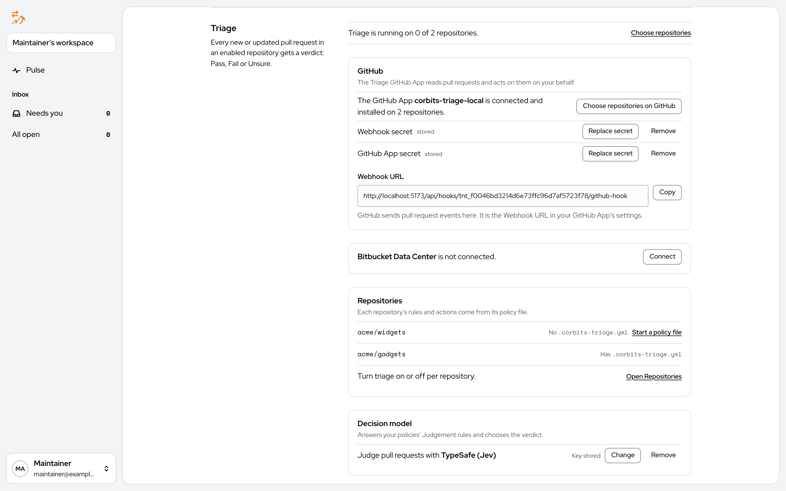

The first line says how many repositories Triage is running on, with a **Choose repositories** link. Until a decision model is added, it says **Triage needs a decision model before it can run. Add one below.**

#### GitHub and Bitbucket Data Center

Triage reads pull requests from GitHub, Bitbucket Data Center, or both. Each has a card of its own.

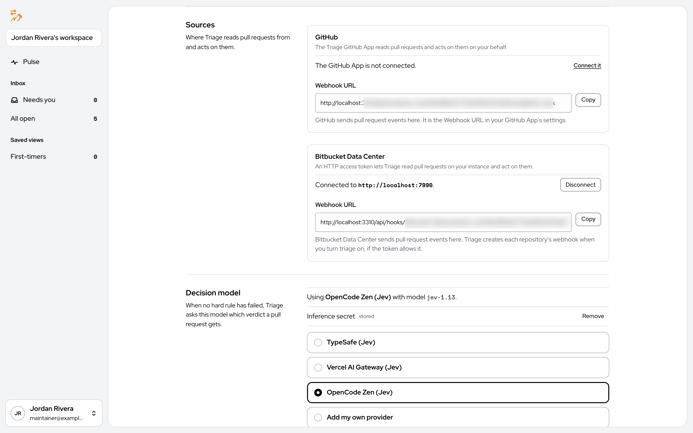

A host that is not connected takes one line with a **Connect** button. The **GitHub** card shows whether the GitHub App is connected and how many repositories it is installed on. Press **Choose repositories on GitHub** to add or remove repositories. GitHub's own installer opens, and when you come back, any new repository appears under Repositories with triage switched off.

Below that are the secrets the App needs: the GitHub App and its webhook secret. The webhook secret has a **Rotate secret** button, and owners and admins can **Replace key** on the GitHub App row (see [Rolling credentials](#rolling-credentials)). If Triage cannot renew its access to GitHub, the GitHub App row says why and what to check, and once the access has run out the GitHub source says so; Triage runs again on its own once GitHub answers. Each has a **Remove** link; removing the GitHub App deletes its private key and disconnects Triage from GitHub, so do that only when you mean to. The **Webhook URL** is what GitHub uses to tell Triage about pull request events. You only need it if you set up the App by hand.

The **Bitbucket Data Center** card reaches an instance with an HTTP access token. To connect one, press **Connect**, enter the **Instance URL**, such as `https://bitbucket.example.com`, paste the **HTTP access token** and press **Connect**. Triage tries the token once and stores it in the server's vault only if the instance accepts it. If your instance is on a private network, the person who runs your Triage server must allow its address first; until then Triage refuses the URL, and a workspace already connected to it stops reading from it.

Create the token for a dedicated Bitbucket user named **Corbits Triage**, not for a person, so that Triage's comments and reviews show under that name. **Download the Corbits Triage avatar** gives you a picture for that user. The token needs:

| Permission | For |
| --- | --- |
| Project read | Listing projects and repositories |
| Repository write | What Triage does on pull requests |
| Repository admin | Creating each repository's webhook. Without it, a repository admin sets the webhook up by hand (see [Bitbucket Data Center repositories](#bitbucket-data-center-repositories)). |

Once connected, the card says **Connected to** the instance and shows the **Webhook URL**, where Bitbucket sends pull request events. Triage creates each repository's webhook when you turn triage on, if the token allows it. **Disconnect** stops triage on every Bitbucket Data Center repository and removes the webhooks Triage created; their rules are kept. If a webhook cannot be removed, the card names the repositories where an admin must delete it by hand. **Replace token** and the webhook secret's **Rotate secret** are described under [Rolling credentials](#rolling-credentials).

#### Repositories

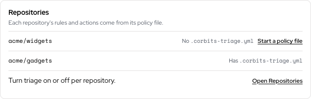

Lists each connected repository and whether its default branch has a `.corbits-triage.yml` policy file. A repository with triage on and no file has a **Start a policy file** link to its repository page, where the steps are (see [Policy](#policy)). **Open Repositories** is where triage is turned on or off per repository.

#### Decision model

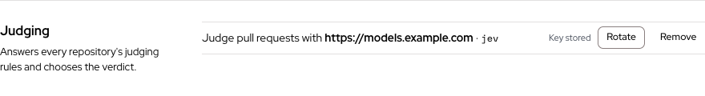

**Judge pull requests with** names the decision model in use, by its provider, or by its address and model name for your own provider. It answers your policies' Judgement rules and chooses the verdict.

The row says **Key stored** or **No key**. With no key, its form is open below it: pick one of the listed providers and paste its API key, or choose **Add my own provider** and enter the address of a compatible service. **Change** opens the form again to replace the key, and **Remove** deletes it after you confirm. Keys are kept in the server's vault and never shown again. Every save of the decision model redeploys Triage's workers, so give it a minute before expecting new verdicts.

#### Rolling credentials

Every secret Triage holds can be replaced from Settings without disconnecting anything. After a GitHub or Bitbucket Data Center secret is replaced, Triage restarts its workers for that host, and code review uses the new value from its next review. If the restart fails, the row says **Saved. Restarting Triage failed; try again** with a **Try again** button; the new secret is already saved.

**GitHub App key.** Press **Replace key** on the GitHub App row. In your App's settings on GitHub, generate a new private key, then choose the downloaded `.pem` file and press **Save**; GitHub checks that the key belongs to the connected App before it is saved. Then delete the old key on GitHub. To switch to another App, use **Create GitHub App**.

**GitHub webhook secret.** Press **Rotate secret** on the webhook row. Triage makes a new secret and shows it once: paste it as the webhook secret in your App's settings on GitHub straight away, then press **I pasted it on GitHub**. Pull requests that change before you paste it are picked up automatically.

**Bitbucket Data Center token.** Press **Replace token**, paste a new HTTP access token for the Corbits Triage user with the same permissions and press **Save**. Triage tries it against your instance and keeps the old token if the instance refuses it. Then revoke the old token in Bitbucket.

**Bitbucket Data Center webhook secret.** Press **Rotate secret** on the webhook secret row. Triage saves a new secret and updates every webhook it created to use it. Repositories whose webhook was set up by hand, or whose webhook Triage could not update, are named afterwards: each one's repository page shows the new secret, so update its webhook in Bitbucket from there. Pull requests that change in the meantime are picked up automatically.

**Model keys.** Press **Change** on the [decision model](#decision-model) or on the Anthropic key under [Code review](#code-review-2) and paste the new key. Triage restarts its workers for every host.

### Code review

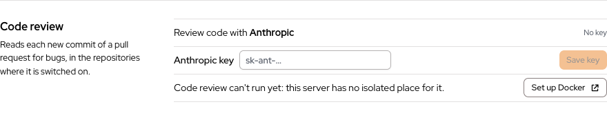

[Code review](#code-review) runs with the provider whose key is stored here; today that is Anthropic. **Review code with Anthropic** says **Key stored** or **No key**; with no key, paste it and press **Save key**. **Change** and **Remove** work as for the decision model.

Below it, **Where it runs** lists every isolated place this server can run code review, such as **Docker on this machine**, **Docker on another machine (TLS)** **E2B sandboxes** and **Railway Sandboxes**, each with a line on why you would choose it. Code review never runs inside Triage itself. It runs in the first place in the list, in the order shown, that is ready. When that place is full, new reviews wait there for room; they do not move to the next place.

Each place says **In use**, **Ready**, **Not set up** or **Failing**; admins also see why it is failing. Under a failing place are the lines to add to the Triage server's `.env`, with **Copy**, and its **Setup guide**; under a place that is not set up, press **How to set it up** to show them. Add them, restart the server, and the place turns **Ready** or **In use**. For **Docker on another machine (TLS)**, the lines carry the certificates themselves, each as one line of base64, so nothing is copied onto the server's disk; its setup guide shows how to make them.

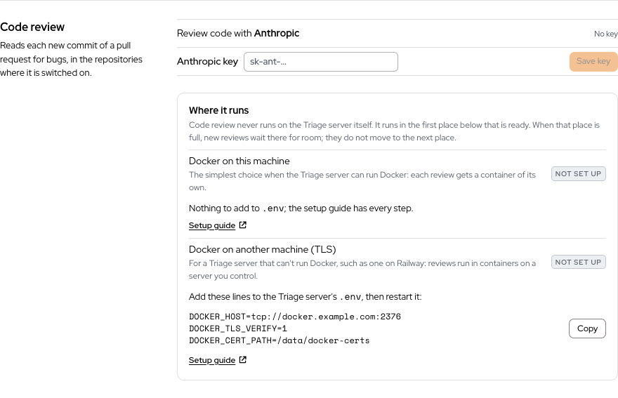

If the server cannot say where code review runs, **Where it runs** is replaced by **Could not read where code review runs** with the reason, and repository pages leave out their Code review section. The rest of the portal works as usual; reload the page to try again.

### People

**People** lists everyone in the workspace with their role. To add a teammate, type their email, choose a role and press **Invite**. They receive a sign-in link that works once and expires after 15 minutes. If your server is not set up to send email, you can invite only people who have already signed in, and the portal shows you the link to copy and send yourself.

If your server is not set up to send email, someone who signed up with an email and password shows **Email not verified**, or **Invite pending** while invited, and if you are the first person who used this Corbits Triage, a **Mark verified** button. Press it only if you know the address is theirs: it lets them into the portal, and they can then accept your invite.

There are three roles:

| Role | What they can do |
| --- | --- |
| Owner | Everything, including workspace settings and inviting people. The person who created the workspace is its owner. |
| Admin | Manage repositories, rules and people. |
| Member | Use the Inbox and approve the held actions their role allows. |

Once a source is connected, an admin can also be a **Deployer**. Deployers publish Triage's workflows, which then run with their permissions, so give the role only to admins you trust with them. Owners and admins see **Make Deployer** on each admin's row, and **Remove Deployer** on every row that has the role, such as an admin since made a member; owners can already do everything a Deployer can. The **Role** column lists every role a person holds, such as **Admin, Deployer**. Someone without the role who tries to publish is told to ask a workspace owner.

### Your account

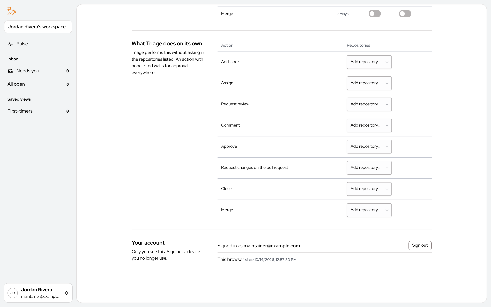

Shows the email address you are signed in with, a **Sign out** button and the browsers you are signed in on. Only you see this section.

#### Sign in a device

A command-line tool or coding agent signs in through the portal. Open the link it gives you, or **/device** on the portal, enter the code it shows and press **Continue**. Check the tool's name and code, then press **Approve**, or **Deny** if you didn't start it. An approved device can do everything you can. Sign it out under **Settings → Your account**.

## The audit log

The audit log is a record of everything that happened in your workspace: who approved what, which actions Triage carried out, which permissions were granted, and when. Open it by adding **/audit** to the end of the portal address, for example `https://triage.example.com/audit`.

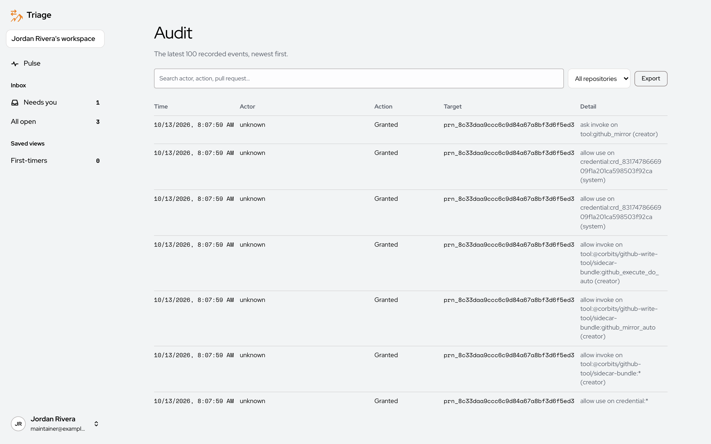

The page shows the latest 100 events, newest first. Each row has:

- **Time** the event happened.
- **Actor**: the person or system component that did it. Events the server did on its own show as unknown.
- **Action**: what was done, such as Granted, Approved or Merged.
- **Target**: what it was done to, such as a pull request or an internal account.
- **Detail**: a short description.

Type in the search box to narrow the list by actor, action or pull request. The dropdown limits the list to one repository. **Export** downloads what you are looking at as a file you can keep or send to someone. Many of the earliest entries are permission grants made automatically when Triage set itself up, which is normal.

## Glossary and common questions

### Words you will see

| Word | What it means here |
| --- | --- |
| Pull request | A proposed change to a repository on GitHub or Bitbucket Data Center, waiting to be reviewed and merged. |
| Repository | One project's code, such as acme/widgets on GitHub or TRI/widgets on Bitbucket Data Center. |
| Source | Where pull requests live: GitHub or Bitbucket Data Center. Connected under Settings → Triage. |
| Workspace | Your team's shared space in Triage. One workspace can watch many repositories. |
| Portal | The Triage website. |
| Hub | The Triage server behind the portal. You never use it directly. |
| GitHub App | The connection between Triage and GitHub. Installing it on a repository lets Triage read pull requests and, if you allow it, write labels, comments and reviews. |
| HTTP access token | The connection between Triage and Bitbucket Data Center, created for a Bitbucket user named Corbits Triage. |
| Build status | The pass or fail mark Bitbucket shows beside a commit. Triage writes its verdict there as **Corbits Triage**, since Bitbucket has no labels. |
| Rule | One question Triage asks about a pull request, answered pass, fail or unconfirmed. |
| Decision model | The AI service that answers questions needing judgment, and that gives the final verdict when the policy has Judgement rules. Set under Settings → Triage. |
| Verdict | Triage's overall answer for one commit of a pull request: Pass, Fail or Unsure. |
| Score | How sure the decision model is that the pull request passes, from 0 to 1. A score of 0.9 means 90 percent sure. |
| Action | One step in a repository's policy, such as adding a label or requesting a review. |
| Held action | An action that is waiting for a person to approve it in the Inbox. |
| Policy | A repository's rules, verdict steps and labels, kept in its `.corbits-triage.yml` file. |
| Role | A workspace role (Owner, Admin, Member) that controls what a person may do in Triage. |
| CI | Continuous integration: the automated tests and checks a repository runs on every pull request. |
| Draft | A pull request its author has marked as not ready. Triage waits until it is marked ready. |
| Code review | Triage's optional bug finder, switched on per repository or by its policy file. It reads each new commit and lists the bugs it finds in Triage, and on GitHub sends them to the pull request when you ask. |
| Finding | One bug code review reports, with its severity (P0 is the most severe), file and line. |
| First-timer | Someone opening their first pull request in a repository. |
| Webhook | The channel GitHub or Bitbucket uses to tell Triage about new events. |
| Audit log | The record of everything that happened in your workspace. |

### Common questions

**Triage says Unsure. What should I do?** Read the pull request yourself. Unsure means the rules did not catch a problem but the decision model was not confident either way. Approve, request changes or comment as you would normally. If a rule could not run because the host had not finished computing something, such as CI, Triage will check again on its own.

**A pull request shows "Not triaged yet" for a long time.** Check that triage is on for its repository, that its source is still connected under Settings → Triage, and that a decision model key is stored there. If all three look right, open the repository and press **Triage open pull requests again**. On Bitbucket, also check the repository has its **Corbits Triage** webhook.

**Does Triage ever merge, close or approve on its own?** Only if you allow it. A repository's page lists what its policy has Triage do under **Actions Triage takes on its own**, and **Allow** lets Triage do those there without asking. Close is never run automatically on an Unsure verdict, and Merge never on anything but Pass, even when they are allowed.

**Why did Triage not call the decision model for a failing pull request?** When a rule fails, the answer is already Fail, so the model is not asked the verdict question. A repository with no Judgement rules never asks it at all. This saves money and keeps verdicts predictable.

**Code review shows nothing for a pull request.** Check that code review is on in the repository's Code review section, or in its policy file, and that an Anthropic key is stored under Settings → Code review. When the policy file turns it on, it runs only after triage, for the groups in `for` and on the verdicts and paths in `when`. By default it reviews only once the rules in your file that fail a pull request and need no model have passed. CI counts only when `ci-green` is on. Triage's built-in checks, such as a draft or a requested change, don't hold the review back. A pull request that fails one gets its Fail with those reasons and no review, and one whose CI is still running is reviewed once CI passes. Write `when: { rules: any }` to review whatever those rules say. Drafts are not reviewed until they are marked ready. A review takes a minute or two; the section says **Reviewing** while it runs. **Review again** starts a new one. If the Code review section says **Code review needs an isolated place to run**, whoever runs your Triage server sets one up first.

**The author pushed a fix. Do I need to do anything?** No. Every new commit gets its own verdict, and Triage updates its comment. If you had requested changes through Triage and every failed rule is now fixed, Triage withdraws the request for you. If a reviewer requested changes, the pull request moves to **Needs you** for their re-review.

**Can I try new rules without affecting anyone?** Rules change only in the repository's `.corbits-triage.yml`, so every change is reviewed in a pull request and applies once it reaches the default branch. Actions that Triage does not run on its own still wait for a person.

**Where do I change my password?** Sign out. If the sign-in screen shows **Forgot password?**, use it, and a reset link is sent to your email.

**How do I remove someone from the workspace?** The portal does not change roles; an Owner or Admin changes or removes a person's role through the Triage server's API.

**Something looks wrong. What should I tell support?** The repository name and pull request number, what you expected, what you saw, and the versions under **Versions for support** at the bottom of Settings (use its **Copy** button). The audit log's **Export** button gives support a record of what happened.
