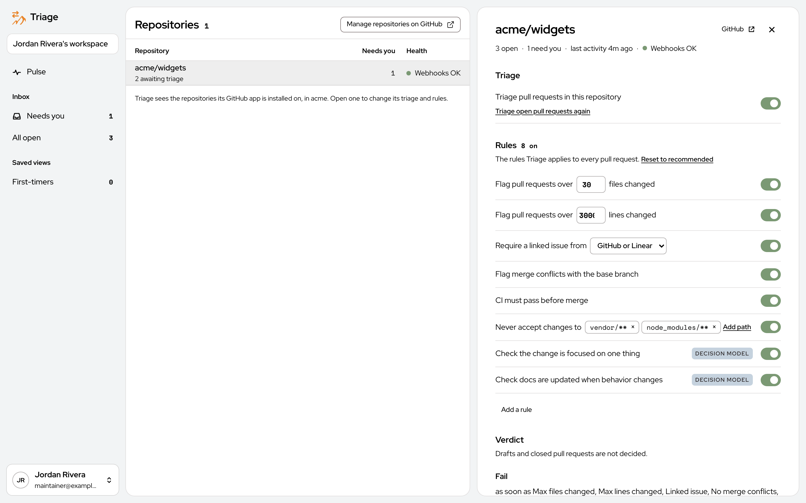
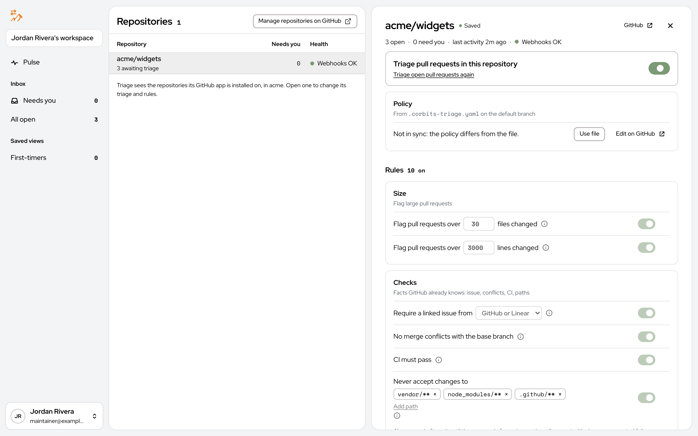
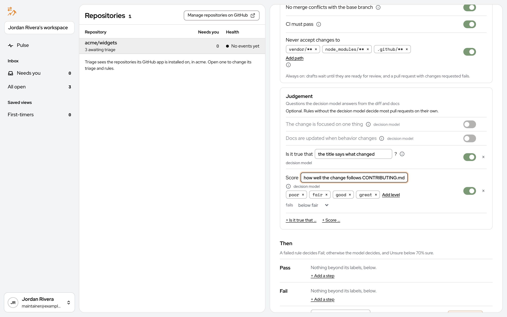
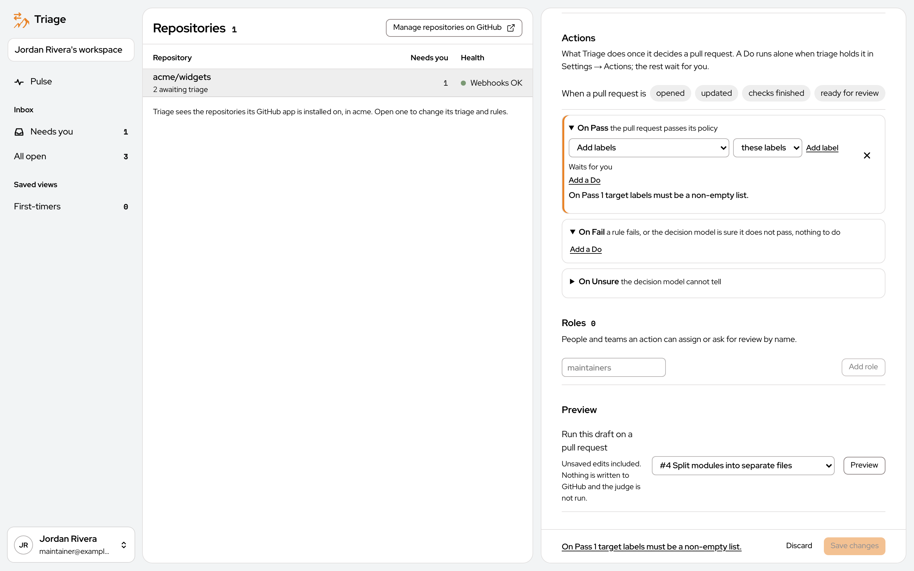
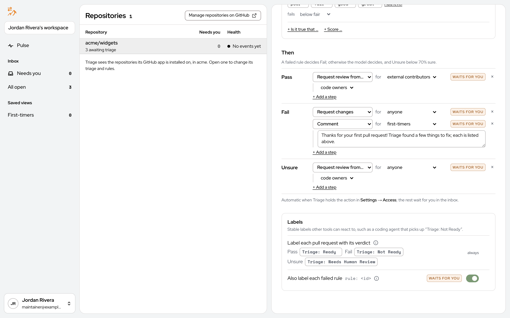
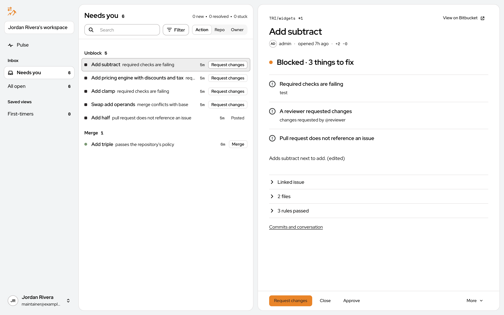
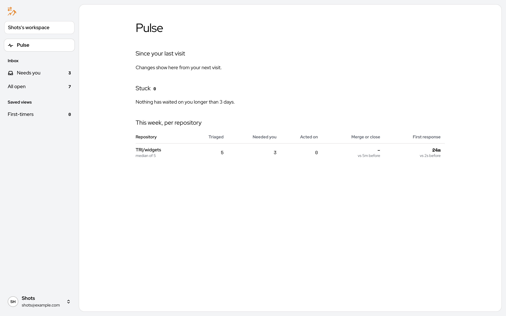

# Corbits Triage User Manual

Oct 13, 2026 · @Brian J. Fox

## What Corbits Triage is

Corbits Triage is an assistant for people who maintain code on GitHub. It looks at every open pull request in the repositories you choose, checks each one against the rules you set, and tells you whether it looks good to merge. Every pull request gets one of three verdicts: **Pass**, **Fail** or **Unsure**, along with a short list of reasons.

Think of it as a first reader. It does the routine checking (Did the tests pass? Is the change too big? Is there a linked issue? Does it need documentation?) so that you can spend your time on the pull requests that actually need a human opinion.

### Who uses it

- **Maintainers** open the portal, a web page where they see each pull request's verdict, its reasons and a suggested next step.
- **Teams** share one workspace. An admin invites teammates by email and decides who may do what.
- **Pull request authors** never need to log in. They only see what Triage writes on GitHub: labels, comments, review requests and assignments.

### What it never does on its own

Nothing runs until you turn it on. Installing the GitHub App only records your repositories, with triage switched off. A repository is checked only after someone turns on **Triage pull requests in this repository** and saves. Even then, a new workspace automates nothing: Triage suggests actions, and a person clicks to carry them out, until you decide which kinds of actions Triage may run by itself.

### The three parts

1. **The portal** is the website you use. This manual is about the portal.
2. **The hub** is the server that stores your settings, talks to GitHub and runs the checks. You normally never see it.
3. **The decision model** is an AI service that answers the judgment questions rules cannot answer from GitHub data alone, such as "Is this change focused on one thing?" You connect it once in Settings.

## Getting started

You use Corbits Triage through a website called the portal. Your administrator will give you its address. Everything in this section happens in a normal web browser.

### Signing in

Open the portal address. You will see the sign-in screen.

Type your email address and password and press **Sign in**. If your organization uses Google sign-in, a **Google** button appears instead of, or below, the password fields. If you forget your password, use the **Forgot password?** link under the password field.

### Creating an account

If you are the first person from your team, click **Sign up for an account**. The form asks for your name, your email address and a password.

Creating an account also creates a **workspace**, the shared space your whole team will use. Teammates do not create their own workspaces. Instead, you invite them from Settings, and they join yours. If someone has already invited you, open the link in the invitation email instead of creating an account from scratch.

### First-time setup

The first time you sign in to a new workspace, the portal walks you through three steps. Until all three are done, Triage does not look at any pull requests.

1. **Connect GitHub.** Triage talks to GitHub through a GitHub App. Press **Create GitHub App** and GitHub opens with a prefilled form for you to confirm. GitHub then sends you back to the portal. The App's private key is stored on the Triage server and is never shown in the browser. If your organization already has a GitHub App for Triage, expand **Connect an existing GitHub App instead** and enter its App ID, its slug, its private key file and its webhook secret. The portal shows the webhook URL you must paste into the App's settings on GitHub.

   
2. **Repositories.** Press **Choose repositories on GitHub** and pick which repositories the App may see. GitHub tells Triage which ones you chose. They arrive with triage switched off, so nothing runs yet.
3. **Decision model.** Pick an AI provider from the list, paste the key your provider gave you, and press **Save decision model**. The key is stored in the server's vault and you will not see it again. If your organization runs its own compatible model service, choose **Add my own provider** and enter its address, model name and key.

You can also invite teammates from this screen by expanding **Invite people**, or do it later from Settings.

### After setup

Once all three steps are done, the portal takes you to the Inbox. Nothing appears there yet, because triage is still off for every repository. The next section shows how to turn it on, and the one after it shows what you will see.

## Setting up a repository: rules, verdicts and actions

Every repository has its own page under **Repositories** in the left rail. That page is where you decide what Triage checks, how it reaches a verdict, and what it does afterward. Nothing on the page takes effect until you press **Save changes** at the bottom.

### Turning triage on

The switch labeled **Triage pull requests in this repository** is the master control. While it is off, Triage ignores the repository entirely. When you turn it on and save, Triage immediately checks every open pull request, and from then on it reacts to each new pull request event as it happens. The link **Triage open pull requests again** re-checks everything that is currently open, which is useful after you change the rules.

### Rules

A rule asks one question about a pull request and answers pass, fail or unconfirmed. The **Rules** list shows every rule, each with a switch. Press **Reset to recommended** to load a sensible starting set. The recommended rules are:

- **Flag pull requests over N files changed** and **over N lines changed**. Big changes are hard to review. You choose the limits.
- **Require a linked issue** from GitHub or Linear. The pull request's description must mention an issue.
- **Flag merge conflicts with the base branch.**
- **CI must pass before merge.** The repository's automated checks must be green.
- **Never accept changes to** certain paths, such as vendored code. Add as many paths as you like.
- **Check the change is focused on one thing** and **Check docs are updated when behavior changes.** These two carry a **Decision model** tag because they need judgment that GitHub data alone cannot provide. The AI model you connected during setup answers them.

Two rules always run and have no switch: a draft pull request is never ready, and a pull request with changes requested is waiting on its author.

Press **Add a rule** to see the other kinds of rules you can add. The plain rules work only from facts GitHub already knows, so they are free and always give the same answer for the same pull request. The decision-model rules cost one model request per pull request.

| Rule | What it checks |
| --- | --- |
| Paths must not change | Fails when any listed path is touched. |
| Paths must change together | When one set of paths changes, another must change too. For example, a change to the API must come with a change to its tests. |
| Title matches a pattern | The title must match a pattern you write. |
| Branch matches a pattern | The branch name must match a pattern you write. |
| Label required | A particular label must be on the pull request. |
| Diff must not contain | Added lines must not contain a pattern, such as a debugging statement. |
| Minimum approvals | At least this many people must have approved. |
| Author is | Records who opened it: named people, a role, or a kind of contributor such as a first-timer or a bot. This one informs the verdict but never fails it. |
| Is it true that... | A yes-or-no question for the decision model. Fails when the answer is no. |
| Score from 0 to 10 | The decision model scores the pull request. Fails below the minimum you set. |

### How the verdict is decided

The **Verdict** section explains the decision in plain words, and it updates as you change the rules.

1. If any plain rule fails, the verdict is **Fail** right away. The model is not consulted, so nothing is spent.
2. Otherwise the decision model reads the whole pull request together with every rule's result and answers one question: does this pull request pass this repository's policy? If it is at least 70% sure the answer is yes, the verdict is **Pass**. If it is at least 70% sure the answer is no, the verdict is **Fail**.
3. Anything in between is **Unsure**, which means a person should look. Triage never guesses.

Draft and closed pull requests are not decided at all.

### Actions

The **Actions** section says what Triage should do once it has a verdict. First, **When a pull request is** lists the events that wake Triage: opened, updated, checks finished and ready for review. All four are on by default.

Below that are three lists of Dos, one per verdict: **On Pass**, **On Fail** and **On Unsure**. Press **Add a Do** to add one. A Do can add labels, assign someone, request a review, post a comment, approve, request changes, or close the pull request. By default, On Unsure asks the code owners for a review.

Each Do shows whether it **Waits for you** or runs on its own. If something is incomplete, such as a label Do with no labels chosen, the page tells you in red and keeps the **Save changes** button disabled until you fix it.

Triage only carries out a Do on its own when your workspace allows that kind of Do under Settings → Access. Everything else waits in the Inbox for a person to click. A brand-new workspace automates nothing, so you can watch what Triage suggests before you let it act.

### Roles and Preview

**Roles** are names for groups of GitHub users or teams, such as maintainers or security. A Do can then say "assign the maintainers" instead of naming people one by one.

**Preview** lets you try your draft rules against one open pull request before saving. Pick a pull request from the dropdown and press **Preview**. Nothing is written to GitHub and the decision model is not run, so it is free and safe to repeat.

## Day to day: the Inbox

Once triage is on, the **Inbox** is where you will spend most of your time. It lists open pull requests, shows each one's verdict and reasons, and offers the next step as a button. Nothing happens on GitHub until you press one of those buttons, unless you have told Triage otherwise in Settings.

### Finding your way around

The dark strip on the left is the same on every page:

- **Workspace name** at the top. If you belong to more than one workspace, click it to switch.
- **Pulse**: a summary of what changed since your last visit.
- **Inbox**, with two views. **Needs you** shows only pull requests waiting on a person. **All open** shows every open pull request in every repository with triage on.
- **Saved views**: ready-made filters. **First-timers** shows pull requests from people who have never contributed to the repository before.
- **Your name** at the bottom. Click it for Repositories, Settings and Sign out.

Each view has a search box, a **Filter** button and quick filters such as Action, Repo, Waits on and Owner. The three counters in the corner show how many pull requests are new since your last visit, how many were resolved, and how many are stuck.

### Needs you

Pull requests are grouped by what you need to do: **Unblock** for ones that are stuck on something, **Merge** for ones that passed, and so on. Each row shows a chip describing the author (Member, First-timer, Bot), the title, Triage's one-line reason, how long ago it was triaged, and a button for the most likely next step. Click anywhere on a row to open it in the reading pane on the right.

### All open

The **All open** view groups pull requests by repository and adds two chips to every row:

| Chip | Meaning |
| --- | --- |
| PASS, FAIL or UNSURE | The verdict. Green means pass, red means fail, and gray means Triage could not tell. |
| WAITS ON YOU, WAITS ON AUTHOR, WAITS ON NOBODY | Whose move it is. |

A pull request that has not been checked yet shows **Not triaged yet** and **Not evaluated** until its first run finishes, usually within a minute of being opened.

### The reading pane

Clicking a pull request opens it on the right. The pane is built to be read top to bottom.

1. **The header**: repository and number, the title, the author with their chip, when it was opened, and how many lines were added and removed. The **GitHub** link in the corner opens the same pull request on GitHub.
2. **The status line** in one sentence, such as **Ready to merge**, **Waiting for review**, or **Blocked · 2 things to fix, 1 to check**.
3. **The problems**, if any. Each failed rule is listed under **To fix** with the evidence, such as the name of the failing check. A rule Triage could not evaluate is listed under **Couldn't check**. A pull request with no problems skips straight to the description.
4. **The description** the author wrote.
5. **Folded rows** you can expand: the linked issue, the changed files (with the diff), and the rules that passed. Evidence for a file cites its changed lines and links them at the exact commit Triage judged.
6. **Commits and conversation** opens the full history and comments.

Expanding **rules passed** shows every rule with a short note on why it passed, such as the number of files changed against the limit. This is the quickest way to see what Triage actually checked.

### Taking action

The bar at the bottom of the pane always offers the next step first. For a passing pull request that is **Merge**, for a failing one it is **Request changes**, and for an unsure one it is usually **Comment** or **Approve**. The other actions are beside it, and anything else, including the Dos the repository's policy suggested, is under **More**.

- **Merge** merges the exact commit Triage checked. If the author pushes a new commit in the meantime, the merge is refused and Triage checks the new commit first.
- **Request changes** sends the author a review listing the rules they need to fix. When they fix them, Triage withdraws the request on its own.
- **Approve** approves the pull request on GitHub. Triage never withdraws an approval you made yourself.
- **Comment** posts a comment, and **Reply** answers the author. Edit feedback lets you reword the comment Triage will post before it goes out.
- **Close** closes the pull request.
- **Triage again** re-runs the checks on the current commit.

Anything you do here is also written to the audit log.

### What the author sees

Authors do not use the portal. Depending on the repository's actions, they see a comment from Triage on their pull request with the verdict and reasons, labels such as **Triage: Ready to merge** or **Triage: Needs changes**, review requests, and assignments. Triage posts one such comment per commit, so an author who pushes a fix gets a fresh verdict.

### Pulse

**Pulse** is the page to open when you come back after a break. It shows what is new, resolved, waiting on you and acted on by you since your last visit, which pull requests have been stuck for more than three days, and a small table per repository: how many pull requests were triaged this week, how many needed a person, how many were acted on, and the typical time to a verdict.

## Settings: people, access and workspace configuration

**Settings** is reached from the menu under your name at the bottom of the left rail. It has six tabs across the top: Triage, GitHub, Integrations, Model, Access and Account. Most teams visit it once during setup and then only to invite people or change who may do what.

### Triage

Shows the version of each Triage component currently running for your workspace. You do not need to change anything here. It is useful when you report a problem, because support will ask which version you are on.

### GitHub

This tab shows whether the GitHub App is connected and how many repositories it is installed on. Press **Choose repositories on GitHub** to add or remove repositories. GitHub's own installer opens, and when you come back, any new repository appears under Repositories with triage switched off. The **Webhook** address is what GitHub uses to tell Triage about pull request events. You only need it if you set up the App by hand.

### Integrations

Reserved for other services Triage can connect to, such as Linear for linked issues. If your workspace has none, this tab is empty.

### Model

This is where the AI decision model lives. Pick one of the listed providers and paste its API key, or choose **Add my own provider** and enter the address of a compatible service. Keys are kept in the server's vault, so after saving the field goes blank and the tab says **API key stored**. To change the key, paste a new one and save again. Every save redeploys Triage's workers, so give it a minute before expecting new verdicts.

### Access

**People** lists everyone in the workspace with their role. To add a teammate, type their email, choose a role and press **Invite**. They receive a sign-in link that works once and expires after 15 minutes. If your server is not set up to send email, the portal shows you the link to copy and send yourself.

There are three roles:

| Role | What they can do |
| --- | --- |
| Owner | Everything, including workspace settings and inviting people. The person who created the workspace is its owner. |
| Admin | Manage repositories, rules and people. |
| Member | Use the Inbox and carry out the actions their role is allowed below. |

**Access** is a grid with one row per kind of action and one column per role, plus a final column called **Triage on its own**. A switch that is on means that role may approve that kind of action when it is waiting in the Inbox. The last column is the important one: when it is on for a kind of action, Triage carries out that action on GitHub by itself during triage, without waiting for anyone. In a new workspace every switch in that column is off. Turn them on one at a time as you gain confidence, starting with low-risk actions such as adding labels.

### Account

Shows your email address, a **Sign out** button and the browsers you are signed in on. Below that are the secrets your workspace holds: the model key, the webhook secret and the GitHub App key. Each has an **Update secret** button for rotating it and a **Remove** link. Removing the GitHub App secret disconnects Triage from GitHub, so do that only when you mean to.

## The audit log

The audit log is a record of everything that happened in your workspace: who approved what, which actions Triage carried out, which permissions were granted, and when. Open it by adding **/audit** to the end of the portal address, for example `https://triage.example.com/audit`.

The page shows the latest 100 events, newest first. Each row has:

- **Time** the event happened.
- **Actor**: the person or system component that did it. Events the server did on its own show as unknown.
- **Action**: what was done, such as Granted, Approved or Merged.
- **Target**: what it was done to, such as a pull request or an internal account.
- **Detail**: a short description.

Type in the search box to narrow the list by actor, action or pull request. The dropdown limits the list to one repository. **Export** downloads what you are looking at as a file you can keep or send to someone. Many of the earliest entries are permission grants made automatically when Triage set itself up, which is normal.

## Glossary and common questions

### Words you will see

| Word | What it means here |
| --- | --- |
| Pull request | A proposed change to a repository on GitHub, waiting to be reviewed and merged. |
| Repository | One project's code on GitHub, such as acme/widgets. |
| Workspace | Your team's shared space in Triage. One workspace can watch many repositories. |
| Portal | The Triage website. |
| Hub | The Triage server behind the portal. You never use it directly. |
| GitHub App | The connection between Triage and GitHub. Installing it on a repository lets Triage read pull requests and, if you allow it, write labels, comments and reviews. |
| Rule | One question Triage asks about a pull request, answered pass, fail or unconfirmed. |
| Decision model | The AI service that answers questions needing judgment, and that gives the final verdict. |
| Verdict | Triage's overall answer for one commit of a pull request: Pass, Fail or Unsure. |
| Score | How sure the decision model is that the pull request passes, from 0 to 1. A score of 0.9 means 90 percent sure. |
| Do | One action in a repository's policy, such as adding a label or requesting a review. |
| Held Do | A Do that is waiting for a person to approve it in the Inbox. |
| Role | Either a workspace role (Owner, Admin, Member) that controls what a person may do in Triage, or a repository role (such as maintainers) that names GitHub users a Do can assign. |
| CI | Continuous integration: the automated tests and checks a repository runs on every pull request. |
| Draft | A pull request its author has marked as not ready. Triage waits until it is marked ready. |
| First-timer | Someone opening their first pull request in a repository. |
| Webhook | The channel GitHub uses to tell Triage about new events. |
| Audit log | The record of everything that happened in your workspace. |

### Common questions

**Triage says Unsure. What should I do?** Read the pull request yourself. Unsure means the rules did not catch a problem but the decision model was not confident either way. Approve, request changes or comment as you would normally. If a rule could not run because GitHub had not finished computing something, such as CI, Triage will check again on its own.

**A pull request shows "Not triaged yet" for a long time.** Check that triage is on for its repository, that the GitHub App is still connected under Settings → GitHub, and that a decision model is saved under Settings → Model. If all three look right, open the repository and press **Triage open pull requests again**.

**Does Triage ever merge, close or approve on its own?** Only if you turn that on. Each kind of action has a switch in the **Triage on its own** column under Settings → Access, and all of them start off. Close is never run automatically on an Unsure verdict even when its switch is on.

**Why did Triage not call the decision model for a failing pull request?** When a plain rule fails, the answer is already Fail, so the model is not asked. This saves money and keeps verdicts predictable.

**The author pushed a fix. Do I need to do anything?** No. Every new commit gets its own verdict, and Triage posts a fresh comment. If you had requested changes through Triage and every failed rule is now fixed, Triage withdraws the request for you.

**Can I try new rules without affecting anyone?** Yes. On the repository page, change the rules, then use **Preview** at the bottom to run the draft against one open pull request. Nothing is written to GitHub. Press **Discard** if you do not want to keep the changes.

**Where do I change my password?** Sign out, then use **Forgot password?** on the sign-in screen. A reset link is sent to your email.

**How do I remove someone from the workspace?** An Owner or Admin can change or remove a person's role under Settings → Access.

**Something looks wrong. What should I tell support?** The repository name and pull request number, what you expected, what you saw, and the versions listed under Settings → Triage. The audit log's **Export** button gives support a record of what happened.
